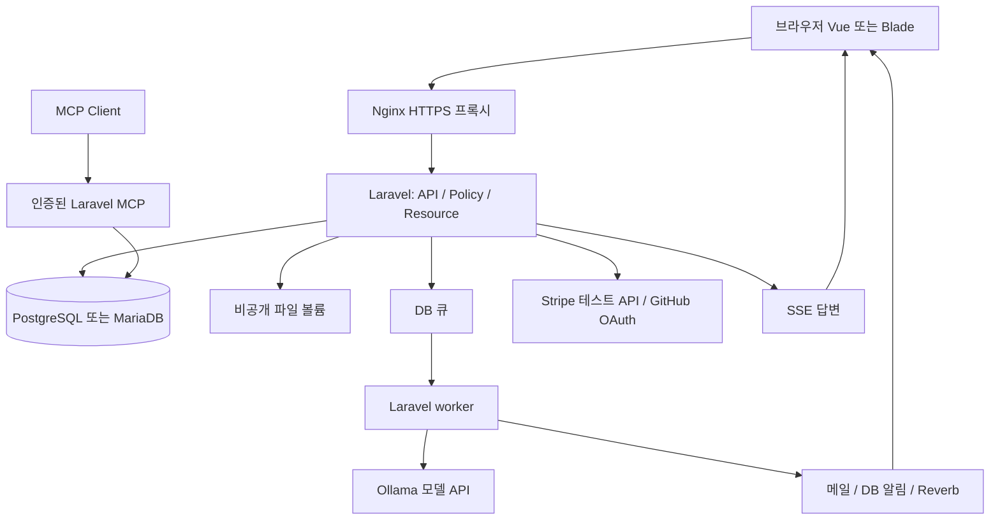

# studyFinal · 심화 응용 · AI 학습 서재

학습 기준: [Laravel 노션](https://app.notion.com/p/3fdd7dec5e2e81299ce9e33e7ba75edf) · 단일 구성: Laravel + Vue · [전체 순서](README.md)

이 저장소는 완성된 학습 소스를 제공한다. 기초는 `demo/`, 심화는 `project/`에서 실행한다. 단계별 파일은 기존 study 문서를 덮어써 갱신했으며, 아래 소스는 현재 저장소의 실제 전문이다. 처음부터 만들 때는 해당 경로의 파일과 앞 단계의 준비를 함께 적용한다.

## ① 목표 한 줄

중간 게시판의 인증·CRUD에 DB 교체·외부 서비스·AI·운영을 결합한 서재를 완성한다.

## ② 📖 이론

### 기능 목록

- User·Note·Tag·note_tag와 댓글, Blade와 Vue CRUD, 검색·페이지·작성자 권한
- 공통 /api 계약·camelCase·오류 봉투·OpenAPI·요청 추적 id
- SQLite 기본 실행, PostgreSQL/MariaDB 전환 절차와 CI, Mongo 보관 모델 선택 예제
- 비공개 TXT/MD 업로드·다운로드·삭제, 큐 요약·질문 이력·메일·알림
- Ollama API·근거 발췌·SSE·인증된 MCP 읽기 서버와 클라이언트
- Stripe 테스트 Checkout·서명 수신 영수증, GitHub OAuth Blade 세션
- Docker app/web/worker/scheduler, GitHub Actions, 볼륨·DB·키 백업과 격리 복원 절차

### 연동 구성도



Laravel이 인증·데이터·외부 호출·AI 중계를 담당하고 Vue는 같은 앱의 화면이다. DB와 모델 공급자는 연결 대상이며 별도 백엔드 프레임워크를 두지 않는다.

## ③ 🛠️ 실기 · 전체 코드와 줄별 설명

### 구현 순서

1. midpoint의 요청·검증·소유권·테스트 흐름을 확인한다. project의 Note·Tag와 다대다 관계로 주제를 서재로 확장한다.
2. study11의 DB 연결을 선택한다. 원본 DB를 보존하고 마이그레이션·데이터 이전·건수·FK·원복을 검증한다. Mongo는 선택 보관 실험으로 분리한다.
3. study12·14의 Vue와 공통 API를 맞추고 OpenAPI에서 요청·응답을 대조한다.
4. study13의 파일·메일·OAuth·테스트 결제를 설정한다. 결제 영수증 수신과 실제 유료 권한 부여를 구분한다.
5. study15의 큐·고유 job·타임아웃·캐시 무효화를 적용한다. study17에서 private 알림과 파일 소유권을 검증한다.
6. study18의 mock 흐름부터 완주한 뒤 실제 Ollama로 전환하고 근거 없는 질문·주입 문서·연결 중단을 평가한다. MCP도 같은 소유권을 적용한다.
7. study16의 Docker 이미지·환경변수·DB·파일 볼륨을 연결한다. CI 성공 후 배포 비밀값을 설정한 환경에서 자동 배포한다.
8. 전체 테스트·빌드·의존성 감사를 실행하고 배포 후 기능·보안·로그·백업 복원을 검수한다.

전체 소스는 project에 있으며 아래에는 최종 조립의 핵심 파일을 전문으로 수록한다. AI·외부 연동·배포 코드 전문은 study13·16·17·18에서 연결해 읽는다.

### 실행 명령

```powershell
cd project
composer install
npm ci
php artisan migrate
# 로컬 연습에서만: php artisan db:seed
npm run build
php artisan test --compact
composer audit
npm audit --omit=dev
php artisan serve --host=127.0.0.1 --port=8001
# 별도 터미널: php artisan queue:work --tries=3 --timeout=100
# 최종 화면: http://127.0.0.1:8001/app
```

명령은 위에서 아래로 실행한다. `cd`는 작업 폴더 이동, `php artisan`은 Laravel 작업, `composer`는 PHP 의존성, `npm`은 Vue 자산 도구, `docker compose`는 연결 서비스를 담당한다. 주석에 별도 터미널·운영 환경·선택 실습이 지정되어 있으면 그 경계를 유지한다.

### `project/routes/api.php` 전체 코드

[project/routes/api.php](project/routes/api.php)를 해당 경로에 둔다. 아래 블록에는 생략된 코드가 없다.

```php
<?php

use App\Http\Controllers\Api\V1\NoteController;
use App\Http\Controllers\Api\V1\TagController;
use App\Http\Controllers\Api\V1\TokenController;
use Illuminate\Support\Facades\Route;

Route::prefix('v1')->group(function () {
    Route::post('/login', [TokenController::class, 'store']);
    Route::get('/notes', [NoteController::class, 'index']);
    Route::get('/notes/{note}', [NoteController::class, 'show']);
    Route::get('/tags', [TagController::class, 'index']);

    Route::middleware('auth:sanctum')->group(function () {
        Route::post('/logout', [TokenController::class, 'destroy']);
        Route::post('/notes', [NoteController::class, 'store']);
        Route::match(['put', 'patch'], '/notes/{note}', [NoteController::class, 'update']);
        Route::delete('/notes/{note}', [NoteController::class, 'destroy']);
    });
});

use App\Http\Controllers\Api\AuthController as ContractAuth;
use App\Http\Controllers\Api\CommentContractController;
use App\Http\Controllers\Api\ContractController;
use App\Http\Controllers\Api\DocumentController;
use App\Http\Controllers\IntegrationController;
use App\Services\LibraryStats;
use Illuminate\Http\Request;

Route::post('/auth/signup', [ContractAuth::class, 'signup'])->middleware('throttle:10,1');
Route::post('/auth/login', [ContractAuth::class, 'login'])->middleware('throttle:10,1');
Route::get('/posts', [ContractController::class, 'index']);
Route::get('/posts/{id}', [ContractController::class, 'show'])->whereNumber('id');
Route::middleware('auth:sanctum')->group(function () {
    Route::get('/auth/me', [ContractAuth::class, 'me']);
    Route::post('/auth/logout', [ContractAuth::class, 'logout']);
    Route::post('/posts', [ContractController::class, 'store']);
    Route::patch('/posts/{id}', [ContractController::class, 'update'])->whereNumber('id');
    Route::delete('/posts/{id}', [ContractController::class, 'destroy'])->whereNumber('id');
});

Route::post('/webhooks/stripe', [IntegrationController::class, 'webhook']);
Route::middleware(['auth:sanctum', 'throttle:30,1'])->group(function () {
    Route::get('/documents', [DocumentController::class, 'index']);
    Route::post('/documents', [DocumentController::class, 'store']);
    Route::get('/documents/{document}/download', [DocumentController::class, 'download']);
    Route::delete('/documents/{document}', [DocumentController::class, 'destroy']);
    Route::get('/documents/{document}/questions', [DocumentController::class, 'history']);
    Route::post('/documents/{document}/ask', [DocumentController::class, 'ask'])->middleware('throttle:6,1');
    Route::get('/notifications', fn (Request $request) => response()->json(['data' => $request->user()->notifications()->latest()->limit(20)->get()->map(fn ($item) => [
        'id' => $item->id, 'data' => $item->data, 'readAt' => $item->read_at?->utc()->toISOString(), 'createdAt' => $item->created_at?->utc()->toISOString(),
    ])]));
    Route::post('/checkout', [IntegrationController::class, 'checkout']);
});

Route::get('/posts/{post}/comments', [CommentContractController::class, 'index'])->whereNumber('post');
Route::post('/posts/{post}/comments', [CommentContractController::class, 'store'])->middleware('auth:sanctum')->whereNumber('post');
Route::delete('/comments/{comment}', [CommentContractController::class, 'destroy'])->middleware('auth:sanctum')->whereNumber('comment');

Route::get('/posts/{invalid}', fn () => abort(400))->where('invalid', '[^0-9/]+');

Route::get('/stats', fn (LibraryStats $stats) => response()->json(['data' => ['total' => $stats->total()]]));
```

#### 줄별 설명

| 줄 | 설명 |
|---:|---|
| 1 | PHP 코드 시작을 선언한다. |
| 2 | 가독성을 위한 빈 줄이며 실행 동작은 없다. |
| 3 | 다른 클래스·트레이트·파사드를 현재 파일의 짧은 이름으로 가져온다. |
| 4 | 다른 클래스·트레이트·파사드를 현재 파일의 짧은 이름으로 가져온다. |
| 5 | 다른 클래스·트레이트·파사드를 현재 파일의 짧은 이름으로 가져온다. |
| 6 | 다른 클래스·트레이트·파사드를 현재 파일의 짧은 이름으로 가져온다. |
| 7 | 가독성을 위한 빈 줄이며 실행 동작은 없다. |
| 8 | HTTP `PREFIX`의 `v1` 주소에 동작·제약을 등록한다. |
| 9 | HTTP `POST`의 `/login` 주소에 동작·제약을 등록한다. |
| 10 | HTTP `GET`의 `/notes` 주소에 동작·제약을 등록한다. |
| 11 | HTTP `GET`의 `/notes/{note}` 주소에 동작·제약을 등록한다. |
| 12 | HTTP `GET`의 `/tags` 주소에 동작·제약을 등록한다. |
| 13 | 가독성을 위한 빈 줄이며 실행 동작은 없다. |
| 14 | HTTP `MIDDLEWARE`의 `auth:sanctum` 주소에 동작·제약을 등록한다. |
| 15 | HTTP `POST`의 `/logout` 주소에 동작·제약을 등록한다. |
| 16 | HTTP `POST`의 `/notes` 주소에 동작·제약을 등록한다. |
| 17 | 라우트 그룹·인증 미들웨어·자원 경로를 묶어서 등록한다. |
| 18 | HTTP `DELETE`의 `/notes/{note}` 주소에 동작·제약을 등록한다. |
| 19 | 현재 블록·배열·호출을 닫고 상위 흐름으로 돌아간다. |
| 20 | 현재 블록·배열·호출을 닫고 상위 흐름으로 돌아간다. |
| 21 | 가독성을 위한 빈 줄이며 실행 동작은 없다. |
| 22 | 다른 클래스·트레이트·파사드를 현재 파일의 짧은 이름으로 가져온다. |
| 23 | 다른 클래스·트레이트·파사드를 현재 파일의 짧은 이름으로 가져온다. |
| 24 | 다른 클래스·트레이트·파사드를 현재 파일의 짧은 이름으로 가져온다. |
| 25 | 다른 클래스·트레이트·파사드를 현재 파일의 짧은 이름으로 가져온다. |
| 26 | 다른 클래스·트레이트·파사드를 현재 파일의 짧은 이름으로 가져온다. |
| 27 | 다른 클래스·트레이트·파사드를 현재 파일의 짧은 이름으로 가져온다. |
| 28 | 다른 클래스·트레이트·파사드를 현재 파일의 짧은 이름으로 가져온다. |
| 29 | 가독성을 위한 빈 줄이며 실행 동작은 없다. |
| 30 | HTTP `POST`의 `/auth/signup` 주소에 동작·제약을 등록한다. |
| 31 | HTTP `POST`의 `/auth/login` 주소에 동작·제약을 등록한다. |
| 32 | HTTP `GET`의 `/posts` 주소에 동작·제약을 등록한다. |
| 33 | HTTP `GET`의 `/posts/{id}` 주소에 동작·제약을 등록한다. |
| 34 | HTTP `MIDDLEWARE`의 `auth:sanctum` 주소에 동작·제약을 등록한다. |
| 35 | HTTP `GET`의 `/auth/me` 주소에 동작·제약을 등록한다. |
| 36 | HTTP `POST`의 `/auth/logout` 주소에 동작·제약을 등록한다. |
| 37 | HTTP `POST`의 `/posts` 주소에 동작·제약을 등록한다. |
| 38 | HTTP `PATCH`의 `/posts/{id}` 주소에 동작·제약을 등록한다. |
| 39 | HTTP `DELETE`의 `/posts/{id}` 주소에 동작·제약을 등록한다. |
| 40 | 현재 블록·배열·호출을 닫고 상위 흐름으로 돌아간다. |
| 41 | 가독성을 위한 빈 줄이며 실행 동작은 없다. |
| 42 | HTTP `POST`의 `/webhooks/stripe` 주소에 동작·제약을 등록한다. |
| 43 | 라우트 그룹·인증 미들웨어·자원 경로를 묶어서 등록한다. |
| 44 | HTTP `GET`의 `/documents` 주소에 동작·제약을 등록한다. |
| 45 | HTTP `POST`의 `/documents` 주소에 동작·제약을 등록한다. |
| 46 | HTTP `GET`의 `/documents/{document}/download` 주소에 동작·제약을 등록한다. |
| 47 | HTTP `DELETE`의 `/documents/{document}` 주소에 동작·제약을 등록한다. |
| 48 | HTTP `GET`의 `/documents/{document}/questions` 주소에 동작·제약을 등록한다. |
| 49 | HTTP `POST`의 `/documents/{document}/ask` 주소에 동작·제약을 등록한다. |
| 50 | HTTP `GET`의 `/notifications` 주소에 동작·제약을 등록한다. |
| 51 | 배열·객체·설정의 키에 값 또는 처리 함수를 연결한다. |
| 52 | 앞서 선언한 처리의 연속 구문이다. 같은 함수·설정 블록의 입력과 결과에 연결된다. |
| 53 | HTTP `POST`의 `/checkout` 주소에 동작·제약을 등록한다. |
| 54 | 현재 블록·배열·호출을 닫고 상위 흐름으로 돌아간다. |
| 55 | 가독성을 위한 빈 줄이며 실행 동작은 없다. |
| 56 | HTTP `GET`의 `/posts/{post}/comments` 주소에 동작·제약을 등록한다. |
| 57 | HTTP `POST`의 `/posts/{post}/comments` 주소에 동작·제약을 등록한다. |
| 58 | HTTP `DELETE`의 `/comments/{comment}` 주소에 동작·제약을 등록한다. |
| 59 | 가독성을 위한 빈 줄이며 실행 동작은 없다. |
| 60 | HTTP `GET`의 `/posts/{invalid}` 주소에 동작·제약을 등록한다. |
| 61 | 가독성을 위한 빈 줄이며 실행 동작은 없다. |
| 62 | HTTP `GET`의 `/stats` 주소에 동작·제약을 등록한다. |


### `project/app/Models/Note.php` 전체 코드

[project/app/Models/Note.php](project/app/Models/Note.php)를 해당 경로에 둔다. 아래 블록에는 생략된 코드가 없다.

```php
<?php

namespace App\Models;

use Illuminate\Database\Eloquent\Attributes\Fillable;
use Illuminate\Database\Eloquent\Builder;
use Illuminate\Database\Eloquent\Model;
use Illuminate\Database\Eloquent\Relations\BelongsTo;
use Illuminate\Database\Eloquent\Relations\BelongsToMany;
use Illuminate\Database\Eloquent\Relations\HasMany;

#[Fillable(['title', 'body'])]
class Note extends Model
{
    public function comments(): HasMany
    {
        return $this->hasMany(Comment::class);
    }

    public function user(): BelongsTo
    {
        return $this->belongsTo(User::class);
    }

    public function tags(): BelongsToMany
    {
        return $this->belongsToMany(Tag::class);
    }

    public function scopeSearch(Builder $query, ?string $term): Builder
    {
        $term = trim((string) $term);
        if ($term === '') {
            return $query;
        }

        $like = '%'.$term.'%';

        return $query->where(function (Builder $inner) use ($like) {
            $inner->whereLike('title', $like)->orWhereLike('body', $like);
        });
    }

    public function scopeTagged(Builder $query, ?string $tag): Builder
    {
        $tag = trim((string) $tag);
        if ($tag === '') {
            return $query;
        }

        return $query->whereHas('tags', fn (Builder $inner) => $inner->where('name', $tag));
    }

    public function syncTagString(?string $raw): void
    {
        $this->syncTagNames(preg_split('/[,，]/u', (string) $raw) ?: []);
    }

    public function syncTagNames(array $raw): void
    {
        $names = collect($raw)
            ->map(fn ($name) => trim((string) $name))
            ->filter(fn ($name) => $name !== '')
            ->unique()
            ->take(8)
            ->map(fn ($name) => mb_substr($name, 0, 30));

        $ids = $names->map(fn (string $name) => Tag::query()->firstOrCreate(['name' => $name])->id);

        $this->tags()->sync($ids->all());
    }
}
```

#### 줄별 설명

| 줄 | 설명 |
|---:|---|
| 1 | PHP 코드 시작을 선언한다. |
| 2 | 가독성을 위한 빈 줄이며 실행 동작은 없다. |
| 3 | 이 클래스가 속한 이름 공간을 지정해 같은 이름의 충돌을 막는다. |
| 4 | 가독성을 위한 빈 줄이며 실행 동작은 없다. |
| 5 | 다른 클래스·트레이트·파사드를 현재 파일의 짧은 이름으로 가져온다. |
| 6 | 다른 클래스·트레이트·파사드를 현재 파일의 짧은 이름으로 가져온다. |
| 7 | 다른 클래스·트레이트·파사드를 현재 파일의 짧은 이름으로 가져온다. |
| 8 | 다른 클래스·트레이트·파사드를 현재 파일의 짧은 이름으로 가져온다. |
| 9 | 다른 클래스·트레이트·파사드를 현재 파일의 짧은 이름으로 가져온다. |
| 10 | 다른 클래스·트레이트·파사드를 현재 파일의 짧은 이름으로 가져온다. |
| 11 | 가독성을 위한 빈 줄이며 실행 동작은 없다. |
| 12 | PHP 속성으로 클래스의 허용 필드·이름·버전·설명을 선언한다. |
| 13 | 앞서 선언한 처리의 연속 구문이다. 같은 함수·설정 블록의 입력과 결과에 연결된다. |
| 14 | 현재 선언·조건·설정의 내부 블록을 연다. |
| 15 | `comments` 메서드를 선언한다. 호출자에게 제공할 입력·출력 경계를 정한다. |
| 16 | 현재 선언·조건·설정의 내부 블록을 연다. |
| 17 | 현재 모델의 자식 여러 건을 찾는 관계를 정의한다. |
| 18 | 현재 블록·배열·호출을 닫고 상위 흐름으로 돌아간다. |
| 19 | 가독성을 위한 빈 줄이며 실행 동작은 없다. |
| 20 | `user` 메서드를 선언한다. 호출자에게 제공할 입력·출력 경계를 정한다. |
| 21 | 현재 선언·조건·설정의 내부 블록을 연다. |
| 22 | 현재 모델에서 소유자나 부모 한 건을 찾는 관계를 정의한다. |
| 23 | 현재 블록·배열·호출을 닫고 상위 흐름으로 돌아간다. |
| 24 | 가독성을 위한 빈 줄이며 실행 동작은 없다. |
| 25 | `tags` 메서드를 선언한다. 호출자에게 제공할 입력·출력 경계를 정한다. |
| 26 | 현재 선언·조건·설정의 내부 블록을 연다. |
| 27 | 현재 모델에서 소유자나 부모 한 건을 찾는 관계를 정의한다. |
| 28 | 현재 블록·배열·호출을 닫고 상위 흐름으로 돌아간다. |
| 29 | 가독성을 위한 빈 줄이며 실행 동작은 없다. |
| 30 | `scopeSearch` 메서드를 선언한다. 호출자에게 제공할 입력·출력 경계를 정한다. |
| 31 | 현재 선언·조건·설정의 내부 블록을 연다. |
| 32 | 이후 처리에 사용할 값이나 의존성을 변수·객체 속성에 저장한다. |
| 33 | 조건을 검사해 성공·실패 또는 선택 기능의 흐름을 나눈다. |
| 34 | 구성한 값·모델·응답을 현재 함수의 호출자에게 돌려준다. |
| 35 | 현재 블록·배열·호출을 닫고 상위 흐름으로 돌아간다. |
| 36 | 가독성을 위한 빈 줄이며 실행 동작은 없다. |
| 37 | 이후 처리에 사용할 값이나 의존성을 변수·객체 속성에 저장한다. |
| 38 | 가독성을 위한 빈 줄이며 실행 동작은 없다. |
| 39 | 사용자 입력을 바인딩한 조회 조건을 추가한다. |
| 40 | DB 드라이버에 맞는 부분 일치 검색 조건을 만든다. |
| 41 | 현재 블록·배열·호출을 닫고 상위 흐름으로 돌아간다. |
| 42 | 현재 블록·배열·호출을 닫고 상위 흐름으로 돌아간다. |
| 43 | 가독성을 위한 빈 줄이며 실행 동작은 없다. |
| 44 | `scopeTagged` 메서드를 선언한다. 호출자에게 제공할 입력·출력 경계를 정한다. |
| 45 | 현재 선언·조건·설정의 내부 블록을 연다. |
| 46 | 이후 처리에 사용할 값이나 의존성을 변수·객체 속성에 저장한다. |
| 47 | 조건을 검사해 성공·실패 또는 선택 기능의 흐름을 나눈다. |
| 48 | 구성한 값·모델·응답을 현재 함수의 호출자에게 돌려준다. |
| 49 | 현재 블록·배열·호출을 닫고 상위 흐름으로 돌아간다. |
| 50 | 가독성을 위한 빈 줄이며 실행 동작은 없다. |
| 51 | 사용자 입력을 바인딩한 조회 조건을 추가한다. |
| 52 | 현재 블록·배열·호출을 닫고 상위 흐름으로 돌아간다. |
| 53 | 가독성을 위한 빈 줄이며 실행 동작은 없다. |
| 54 | `syncTagString` 메서드를 선언한다. 호출자에게 제공할 입력·출력 경계를 정한다. |
| 55 | 현재 선언·조건·설정의 내부 블록을 연다. |
| 56 | 배열·객체·설정의 키에 값 또는 처리 함수를 연결한다. |
| 57 | 현재 블록·배열·호출을 닫고 상위 흐름으로 돌아간다. |
| 58 | 가독성을 위한 빈 줄이며 실행 동작은 없다. |
| 59 | `syncTagNames` 메서드를 선언한다. 호출자에게 제공할 입력·출력 경계를 정한다. |
| 60 | 현재 선언·조건·설정의 내부 블록을 연다. |
| 61 | 이후 처리에 사용할 값이나 의존성을 변수·객체 속성에 저장한다. |
| 62 | 배열·객체·설정의 키에 값 또는 처리 함수를 연결한다. |
| 63 | 배열·객체·설정의 키에 값 또는 처리 함수를 연결한다. |
| 64 | 앞서 선언한 처리의 연속 구문이다. 같은 함수·설정 블록의 입력과 결과에 연결된다. |
| 65 | 앞서 선언한 처리의 연속 구문이다. 같은 함수·설정 블록의 입력과 결과에 연결된다. |
| 66 | UTF-8 문자 기준으로 텍스트 길이를 제한한다. |
| 67 | 가독성을 위한 빈 줄이며 실행 동작은 없다. |
| 68 | 모델에 대응하는 테이블 또는 컬렉션의 조회를 시작한다. |
| 69 | 가독성을 위한 빈 줄이며 실행 동작은 없다. |
| 70 | 앞서 선언한 처리의 연속 구문이다. 같은 함수·설정 블록의 입력과 결과에 연결된다. |
| 71 | 현재 블록·배열·호출을 닫고 상위 흐름으로 돌아간다. |
| 72 | 현재 블록·배열·호출을 닫고 상위 흐름으로 돌아간다. |


### `project/app/Http/Controllers/Api/ContractController.php` 전체 코드

[project/app/Http/Controllers/Api/ContractController.php](project/app/Http/Controllers/Api/ContractController.php)를 해당 경로에 둔다. 아래 블록에는 생략된 코드가 없다.

```php
<?php

namespace App\Http\Controllers\Api;

use App\Http\Controllers\Controller;
use App\Http\Resources\EntryResource;
use App\Services\LibraryStats;
use App\Support\TagNames;
use Illuminate\Http\JsonResponse;
use Illuminate\Http\Request;
use Illuminate\Support\Facades\DB;
use Illuminate\Support\Facades\Gate;
use Symfony\Component\HttpFoundation\Response;

class ContractController extends Controller
{
    public function index(Request $request): JsonResponse
    {
        $request->validate(['q' => ['nullable', 'string', 'max:200'], 'page' => ['sometimes', 'integer', 'min:1'],
            'limit' => ['sometimes', 'integer', 'min:1'], 'sort' => ['sometimes', 'in:createdAt,-createdAt,-commentCount']]);
        $query = config('study.model')::query()->with(['user', 'tags'])->search($request->query('q'));
        $query->withCount('comments');
        $sort = $request->query('sort', '-createdAt');
        if ($sort === '-commentCount') {
            $query->orderByDesc('comments_count');
        } else {
            $query->orderBy('created_at', $sort === 'createdAt' ? 'asc' : 'desc');
        }
        $items = $query->orderBy('id', $sort === 'createdAt' ? 'asc' : 'desc')
            ->paginate(min($request->integer('limit', 10), 50));

        return response()->json(['data' => EntryResource::collection($items)->resolve($request), 'meta' => [
            'page' => $items->currentPage(), 'limit' => $items->perPage(), 'total' => $items->total(),
            'totalPages' => $items->lastPage(), 'q' => $request->query('q', ''),
        ]]);
    }

    public function show(int $id): EntryResource
    {
        return new EntryResource(config('study.model')::query()->with(['user', 'tags'])->withCount('comments')->findOrFail($id));
    }

    public function store(Request $request): JsonResponse
    {
        $data = $this->validated($request);
        if (isset($data['tags'])) {
            $data['tags'] = TagNames::normalize($data['tags']);
        }
        $entry = DB::transaction(function () use ($request, $data) {
            $relation = config('study.relation');
            $entry = $request->user()->{$relation}()->create(array_diff_key($data, ['tags' => true]));
            if (array_key_exists('tags', $data)) {
                $entry->syncTagNames($data['tags']);
            }

            return $entry;
        });
        app(LibraryStats::class)->invalidate();

        return (new EntryResource($entry->load(['user', 'tags'])))->response()->setStatusCode(201)
            ->header('Location', '/api/posts/'.$entry->id);
    }

    public function update(Request $request, int $id): EntryResource
    {
        $entry = config('study.model')::query()->findOrFail($id);
        Gate::authorize('update', $entry);
        $data = $this->validated($request, true);
        if (isset($data['tags'])) {
            $data['tags'] = TagNames::normalize($data['tags']);
        }
        DB::transaction(function () use ($entry, $data): void {
            $entry->update(array_diff_key($data, ['tags' => true]));
            if (array_key_exists('tags', $data)) {
                $entry->syncTagNames($data['tags']);
            }
        });

        return new EntryResource($entry->load(['user', 'tags'])->loadCount('comments'));
    }

    public function destroy(int $id): Response
    {
        $entry = config('study.model')::query()->findOrFail($id);
        Gate::authorize('delete', $entry);
        $entry->delete();
        app(LibraryStats::class)->invalidate();

        return response()->noContent();
    }

    private function validated(Request $request, bool $partial = false): array
    {
        return $request->validate([
            'title' => [$partial ? 'sometimes' : 'required', 'required', 'string', 'max:200'],
            'body' => [$partial ? 'sometimes' : 'required', 'required', 'string', 'max:20000'],
            'tags' => ['sometimes', 'array', 'max:8'], 'tags.*' => ['required', 'string', 'max:30', 'distinct'],
        ]);
    }
}
```

#### 줄별 설명

| 줄 | 설명 |
|---:|---|
| 1 | PHP 코드 시작을 선언한다. |
| 2 | 가독성을 위한 빈 줄이며 실행 동작은 없다. |
| 3 | 이 클래스가 속한 이름 공간을 지정해 같은 이름의 충돌을 막는다. |
| 4 | 가독성을 위한 빈 줄이며 실행 동작은 없다. |
| 5 | 다른 클래스·트레이트·파사드를 현재 파일의 짧은 이름으로 가져온다. |
| 6 | 다른 클래스·트레이트·파사드를 현재 파일의 짧은 이름으로 가져온다. |
| 7 | 다른 클래스·트레이트·파사드를 현재 파일의 짧은 이름으로 가져온다. |
| 8 | 다른 클래스·트레이트·파사드를 현재 파일의 짧은 이름으로 가져온다. |
| 9 | 다른 클래스·트레이트·파사드를 현재 파일의 짧은 이름으로 가져온다. |
| 10 | 다른 클래스·트레이트·파사드를 현재 파일의 짧은 이름으로 가져온다. |
| 11 | 다른 클래스·트레이트·파사드를 현재 파일의 짧은 이름으로 가져온다. |
| 12 | 다른 클래스·트레이트·파사드를 현재 파일의 짧은 이름으로 가져온다. |
| 13 | 다른 클래스·트레이트·파사드를 현재 파일의 짧은 이름으로 가져온다. |
| 14 | 가독성을 위한 빈 줄이며 실행 동작은 없다. |
| 15 | 앞서 선언한 처리의 연속 구문이다. 같은 함수·설정 블록의 입력과 결과에 연결된다. |
| 16 | 현재 선언·조건·설정의 내부 블록을 연다. |
| 17 | `index` 메서드를 선언한다. 목록을 조회해 응답으로 반환하는 진입점이다. |
| 18 | 현재 선언·조건·설정의 내부 블록을 연다. |
| 19 | 서버 경계에서 입력을 검증하고 허용한 필드만 돌려받는다. |
| 20 | 배열·객체·설정의 키에 값 또는 처리 함수를 연결한다. |
| 21 | 관계를 미리 조회하거나 리다이렉트의 일회성 상태값을 전달한다. |
| 22 | 관계 행 수를 추가 쿼리 반복 없이 count 필드로 읽는다. |
| 23 | 이후 처리에 사용할 값이나 의존성을 변수·객체 속성에 저장한다. |
| 24 | 조건을 검사해 성공·실패 또는 선택 기능의 흐름을 나눈다. |
| 25 | 허용한 정렬 기준을 DB 쿼리에 적용한다. |
| 26 | 앞서 선언한 처리의 연속 구문이다. 같은 함수·설정 블록의 입력과 결과에 연결된다. |
| 27 | 허용한 정렬 기준을 DB 쿼리에 적용한다. |
| 28 | 현재 블록·배열·호출을 닫고 상위 흐름으로 돌아간다. |
| 29 | 허용한 정렬 기준을 DB 쿼리에 적용한다. |
| 30 | 전체 건수와 현재 페이지를 계산하고 페이지 크기를 제한한다. |
| 31 | 가독성을 위한 빈 줄이며 실행 동작은 없다. |
| 32 | 계약에 맞는 HTTP 응답 본문·상태·헤더를 만들어 반환한다. |
| 33 | 배열·객체·설정의 키에 값 또는 처리 함수를 연결한다. |
| 34 | 배열·객체·설정의 키에 값 또는 처리 함수를 연결한다. |
| 35 | 앞서 선언한 처리의 연속 구문이다. 같은 함수·설정 블록의 입력과 결과에 연결된다. |
| 36 | 현재 블록·배열·호출을 닫고 상위 흐름으로 돌아간다. |
| 37 | 가독성을 위한 빈 줄이며 실행 동작은 없다. |
| 38 | `show` 메서드를 선언한다. 지정한 자원 한 건을 조회하는 진입점이다. |
| 39 | 현재 선언·조건·설정의 내부 블록을 연다. |
| 40 | 관계 행 수를 추가 쿼리 반복 없이 count 필드로 읽는다. |
| 41 | 현재 블록·배열·호출을 닫고 상위 흐름으로 돌아간다. |
| 42 | 가독성을 위한 빈 줄이며 실행 동작은 없다. |
| 43 | `store` 메서드를 선언한다. 검증한 입력으로 자원을 생성하는 진입점이다. |
| 44 | 현재 선언·조건·설정의 내부 블록을 연다. |
| 45 | 이후 처리에 사용할 값이나 의존성을 변수·객체 속성에 저장한다. |
| 46 | 조건을 검사해 성공·실패 또는 선택 기능의 흐름을 나눈다. |
| 47 | 배열·객체·설정의 키에 값 또는 처리 함수를 연결한다. |
| 48 | 현재 블록·배열·호출을 닫고 상위 흐름으로 돌아간다. |
| 49 | 묶인 DB 변경이 함께 성공하거나 함께 취소되도록 트랜잭션을 연다. |
| 50 | 환경에 맞게 로드한 설정값을 읽는다. |
| 51 | 검증한 속성으로 새 행을 저장하거나 작업 객체를 생성한다. |
| 52 | PATCH에서 누락한 필드와 명시적으로 보낸 필드를 구분한다. |
| 53 | 앞서 선언한 처리의 연속 구문이다. 같은 함수·설정 블록의 입력과 결과에 연결된다. |
| 54 | 현재 블록·배열·호출을 닫고 상위 흐름으로 돌아간다. |
| 55 | 가독성을 위한 빈 줄이며 실행 동작은 없다. |
| 56 | 구성한 값·모델·응답을 현재 함수의 호출자에게 돌려준다. |
| 57 | 현재 블록·배열·호출을 닫고 상위 흐름으로 돌아간다. |
| 58 | 배열·객체·설정의 키에 값 또는 처리 함수를 연결한다. |
| 59 | 가독성을 위한 빈 줄이며 실행 동작은 없다. |
| 60 | 응답에 필요한 관계 데이터를 모델에 추가로 불러온다. |
| 61 | 앞서 선언한 처리의 연속 구문이다. 같은 함수·설정 블록의 입력과 결과에 연결된다. |
| 62 | 현재 블록·배열·호출을 닫고 상위 흐름으로 돌아간다. |
| 63 | 가독성을 위한 빈 줄이며 실행 동작은 없다. |
| 64 | `update` 메서드를 선언한다. 소유권 확인 뒤 전달된 필드만 수정하는 진입점이다. |
| 65 | 현재 선언·조건·설정의 내부 블록을 연다. |
| 66 | 모델에 대응하는 테이블 또는 컬렉션의 조회를 시작한다. |
| 67 | 현재 사용자가 지정한 모델 동작을 수행할 수 있는지 Policy에 묻는다. |
| 68 | 이후 처리에 사용할 값이나 의존성을 변수·객체 속성에 저장한다. |
| 69 | 조건을 검사해 성공·실패 또는 선택 기능의 흐름을 나눈다. |
| 70 | 배열·객체·설정의 키에 값 또는 처리 함수를 연결한다. |
| 71 | 현재 블록·배열·호출을 닫고 상위 흐름으로 돌아간다. |
| 72 | 묶인 DB 변경이 함께 성공하거나 함께 취소되도록 트랜잭션을 연다. |
| 73 | 이미 확인한 행에 전달된 변경값을 저장한다. |
| 74 | PATCH에서 누락한 필드와 명시적으로 보낸 필드를 구분한다. |
| 75 | 앞서 선언한 처리의 연속 구문이다. 같은 함수·설정 블록의 입력과 결과에 연결된다. |
| 76 | 현재 블록·배열·호출을 닫고 상위 흐름으로 돌아간다. |
| 77 | 현재 블록·배열·호출을 닫고 상위 흐름으로 돌아간다. |
| 78 | 가독성을 위한 빈 줄이며 실행 동작은 없다. |
| 79 | 응답에 필요한 관계 데이터를 모델에 추가로 불러온다. |
| 80 | 현재 블록·배열·호출을 닫고 상위 흐름으로 돌아간다. |
| 81 | 가독성을 위한 빈 줄이며 실행 동작은 없다. |
| 82 | `destroy` 메서드를 선언한다. 권한 확인 뒤 자원을 삭제하는 진입점이다. |
| 83 | 현재 선언·조건·설정의 내부 블록을 연다. |
| 84 | 모델에 대응하는 테이블 또는 컬렉션의 조회를 시작한다. |
| 85 | 현재 사용자가 지정한 모델 동작을 수행할 수 있는지 Policy에 묻는다. |
| 86 | 대상 행·토큰·파일을 제거한다. 앞선 소유권 검사를 함께 읽는다. |
| 87 | 배열·객체·설정의 키에 값 또는 처리 함수를 연결한다. |
| 88 | 가독성을 위한 빈 줄이며 실행 동작은 없다. |
| 89 | 계약에 맞는 HTTP 응답 본문·상태·헤더를 만들어 반환한다. |
| 90 | 현재 블록·배열·호출을 닫고 상위 흐름으로 돌아간다. |
| 91 | 가독성을 위한 빈 줄이며 실행 동작은 없다. |
| 92 | `validated` 메서드를 선언한다. 저장할 입력의 타입·길이·필수 여부를 확정한다. |
| 93 | 현재 선언·조건·설정의 내부 블록을 연다. |
| 94 | 서버 경계에서 입력을 검증하고 허용한 필드만 돌려받는다. |
| 95 | 배열·객체·설정의 키에 값 또는 처리 함수를 연결한다. |
| 96 | 배열·객체·설정의 키에 값 또는 처리 함수를 연결한다. |
| 97 | 배열·객체·설정의 키에 값 또는 처리 함수를 연결한다. |
| 98 | 현재 블록·배열·호출을 닫고 상위 흐름으로 돌아간다. |
| 99 | 현재 블록·배열·호출을 닫고 상위 흐름으로 돌아간다. |
| 100 | 현재 블록·배열·호출을 닫고 상위 흐름으로 돌아간다. |


### `project/app/Jobs/SummarizeDocument.php` 전체 코드

[project/app/Jobs/SummarizeDocument.php](project/app/Jobs/SummarizeDocument.php)를 해당 경로에 둔다. 아래 블록에는 생략된 코드가 없다.

```php
<?php

namespace App\Jobs;

use App\Models\Document;
use App\Notifications\DocumentReady;
use App\Services\DocumentAi;
use Illuminate\Contracts\Queue\ShouldBeUnique;
use Illuminate\Contracts\Queue\ShouldQueue;
use Illuminate\Foundation\Queue\Queueable;
use Throwable;

class SummarizeDocument implements ShouldBeUnique, ShouldQueue
{
    use Queueable;

    public int $tries = 3;

    public int $timeout = 100;

    public int $uniqueFor = 180;

    public function uniqueId(): string
    {
        return (string) $this->documentId;
    }

    public function __construct(public int $documentId) {}

    public function backoff(): array
    {
        return [10, 30, 60];
    }

    public function handle(DocumentAi $ai): void
    {
        $document = Document::query()->find($this->documentId);
        if (! $document || $document->status === 'ready') {
            return;
        }
        $document->update(['status' => 'processing']);
        $summary = $ai->summarize($document->content);
        $document->update(['summary' => $summary, 'status' => 'ready']);
        $document->user->notify(new DocumentReady($document->id));
    }

    public function failed(?Throwable $exception): void
    {
        Document::query()->whereKey($this->documentId)->update(['status' => 'failed']);
    }
}
```

#### 줄별 설명

| 줄 | 설명 |
|---:|---|
| 1 | PHP 코드 시작을 선언한다. |
| 2 | 가독성을 위한 빈 줄이며 실행 동작은 없다. |
| 3 | 이 클래스가 속한 이름 공간을 지정해 같은 이름의 충돌을 막는다. |
| 4 | 가독성을 위한 빈 줄이며 실행 동작은 없다. |
| 5 | 다른 클래스·트레이트·파사드를 현재 파일의 짧은 이름으로 가져온다. |
| 6 | 다른 클래스·트레이트·파사드를 현재 파일의 짧은 이름으로 가져온다. |
| 7 | 다른 클래스·트레이트·파사드를 현재 파일의 짧은 이름으로 가져온다. |
| 8 | 다른 클래스·트레이트·파사드를 현재 파일의 짧은 이름으로 가져온다. |
| 9 | 다른 클래스·트레이트·파사드를 현재 파일의 짧은 이름으로 가져온다. |
| 10 | 다른 클래스·트레이트·파사드를 현재 파일의 짧은 이름으로 가져온다. |
| 11 | 다른 클래스·트레이트·파사드를 현재 파일의 짧은 이름으로 가져온다. |
| 12 | 가독성을 위한 빈 줄이며 실행 동작은 없다. |
| 13 | 앞서 선언한 처리의 연속 구문이다. 같은 함수·설정 블록의 입력과 결과에 연결된다. |
| 14 | 현재 선언·조건·설정의 내부 블록을 연다. |
| 15 | 다른 클래스·트레이트·파사드를 현재 파일의 짧은 이름으로 가져온다. |
| 16 | 가독성을 위한 빈 줄이며 실행 동작은 없다. |
| 17 | 이후 처리에 사용할 값이나 의존성을 변수·객체 속성에 저장한다. |
| 18 | 가독성을 위한 빈 줄이며 실행 동작은 없다. |
| 19 | 이후 처리에 사용할 값이나 의존성을 변수·객체 속성에 저장한다. |
| 20 | 가독성을 위한 빈 줄이며 실행 동작은 없다. |
| 21 | 이후 처리에 사용할 값이나 의존성을 변수·객체 속성에 저장한다. |
| 22 | 가독성을 위한 빈 줄이며 실행 동작은 없다. |
| 23 | `uniqueId` 메서드를 선언한다. 같은 문서의 중복 job을 막을 식별자를 반환한다. |
| 24 | 현재 선언·조건·설정의 내부 블록을 연다. |
| 25 | 구성한 값·모델·응답을 현재 함수의 호출자에게 돌려준다. |
| 26 | 현재 블록·배열·호출을 닫고 상위 흐름으로 돌아간다. |
| 27 | 가독성을 위한 빈 줄이며 실행 동작은 없다. |
| 28 | `__construct` 메서드를 선언한다. 호출자에게 제공할 입력·출력 경계를 정한다. |
| 29 | 가독성을 위한 빈 줄이며 실행 동작은 없다. |
| 30 | `backoff` 메서드를 선언한다. 재시도 간격을 초 단위로 돌려준다. |
| 31 | 현재 선언·조건·설정의 내부 블록을 연다. |
| 32 | 구성한 값·모델·응답을 현재 함수의 호출자에게 돌려준다. |
| 33 | 현재 블록·배열·호출을 닫고 상위 흐름으로 돌아간다. |
| 34 | 가독성을 위한 빈 줄이며 실행 동작은 없다. |
| 35 | `handle` 메서드를 선언한다. 큐·미들웨어·MCP가 호출할 작업 진입점이다. |
| 36 | 현재 선언·조건·설정의 내부 블록을 연다. |
| 37 | 모델에 대응하는 테이블 또는 컬렉션의 조회를 시작한다. |
| 38 | 조건을 검사해 성공·실패 또는 선택 기능의 흐름을 나눈다. |
| 39 | 앞서 선언한 처리의 연속 구문이다. 같은 함수·설정 블록의 입력과 결과에 연결된다. |
| 40 | 현재 블록·배열·호출을 닫고 상위 흐름으로 돌아간다. |
| 41 | 이미 확인한 행에 전달된 변경값을 저장한다. |
| 42 | 이후 처리에 사용할 값이나 의존성을 변수·객체 속성에 저장한다. |
| 43 | 이미 확인한 행에 전달된 변경값을 저장한다. |
| 44 | 사용자에게 정의한 알림 채널 전송을 예약한다. |
| 45 | 현재 블록·배열·호출을 닫고 상위 흐름으로 돌아간다. |
| 46 | 가독성을 위한 빈 줄이며 실행 동작은 없다. |
| 47 | `failed` 메서드를 선언한다. 재시도까지 끝난 실패 상태를 기록한다. |
| 48 | 현재 선언·조건·설정의 내부 블록을 연다. |
| 49 | 모델에 대응하는 테이블 또는 컬렉션의 조회를 시작한다. |
| 50 | 현재 블록·배열·호출을 닫고 상위 흐름으로 돌아간다. |
| 51 | 현재 블록·배열·호출을 닫고 상위 흐름으로 돌아간다. |


### `compose.production.yaml` 전체 코드

[compose.production.yaml](compose.production.yaml)를 해당 경로에 둔다. 아래 블록에는 생략된 코드가 없다.

```yaml
name: laravel-study
x-app: &app
  image: ${IMAGE:?Set IMAGE}-app
  env_file: .env.production
  restart: unless-stopped
  volumes: ["private-files:/var/www/html/storage/app"]
  depends_on:
    db:
      condition: service_healthy
services:
  app:
    <<: *app
  worker:
    <<: *app
    command: [php, artisan, queue:work, --sleep=3, --tries=3, --timeout=100]
  scheduler:
    <<: *app
    command: [php, artisan, schedule:work]
  reverb:
    <<: *app
    profiles: [realtime]
    command: [php, artisan, reverb:start, --host=0.0.0.0, --port=8080]
    ports: ["127.0.0.1:8080:8080"]
  web:
    image: ${IMAGE:?Set IMAGE}-web
    restart: unless-stopped
    ports: ["127.0.0.1:8088:80"]
    depends_on: [app]
  db:
    image: postgres:17-alpine
    env_file: .env.production
    restart: unless-stopped
    volumes: ["production-db:/var/lib/postgresql/data"]
    healthcheck:
      test: [CMD-SHELL, "pg_isready -U $$POSTGRES_USER -d $$POSTGRES_DB"]
      interval: 5s
      retries: 10
volumes:
  private-files:
  production-db:
```

#### 줄별 설명

| 줄 | 설명 |
|---:|---|
| 1 | 현재 서비스·작업·단계의 구성 키와 값을 선언한다. |
| 2 | 현재 서비스·작업·단계의 구성 키와 값을 선언한다. |
| 3 | 현재 서비스·작업·단계의 구성 키와 값을 선언한다. |
| 4 | 프로세스가 사용할 환경 설정 경계를 지정한다. |
| 5 | 현재 서비스·작업·단계의 구성 키와 값을 선언한다. |
| 6 | 컨테이너 교체 후에도 보존할 저장 볼륨을 연결한다. |
| 7 | 현재 서비스·작업·단계의 구성 키와 값을 선언한다. |
| 8 | 현재 서비스·작업·단계의 구성 키와 값을 선언한다. |
| 9 | 현재 서비스·작업·단계의 구성 키와 값을 선언한다. |
| 10 | 현재 서비스·작업·단계의 구성 키와 값을 선언한다. |
| 11 | 현재 서비스·작업·단계의 구성 키와 값을 선언한다. |
| 12 | 현재 서비스·작업·단계의 구성 키와 값을 선언한다. |
| 13 | 현재 서비스·작업·단계의 구성 키와 값을 선언한다. |
| 14 | 현재 서비스·작업·단계의 구성 키와 값을 선언한다. |
| 15 | 컨테이너가 시작할 프로세스와 실행 인수를 정의한다. |
| 16 | 현재 서비스·작업·단계의 구성 키와 값을 선언한다. |
| 17 | 현재 서비스·작업·단계의 구성 키와 값을 선언한다. |
| 18 | 컨테이너가 시작할 프로세스와 실행 인수를 정의한다. |
| 19 | 현재 서비스·작업·단계의 구성 키와 값을 선언한다. |
| 20 | 현재 서비스·작업·단계의 구성 키와 값을 선언한다. |
| 21 | 현재 서비스·작업·단계의 구성 키와 값을 선언한다. |
| 22 | 컨테이너가 시작할 프로세스와 실행 인수를 정의한다. |
| 23 | 허용할 호스트 주소·포트와 컨테이너 포트를 연결한다. |
| 24 | 현재 서비스·작업·단계의 구성 키와 값을 선언한다. |
| 25 | 현재 서비스·작업·단계의 구성 키와 값을 선언한다. |
| 26 | 현재 서비스·작업·단계의 구성 키와 값을 선언한다. |
| 27 | 허용할 호스트 주소·포트와 컨테이너 포트를 연결한다. |
| 28 | 현재 서비스·작업·단계의 구성 키와 값을 선언한다. |
| 29 | 현재 서비스·작업·단계의 구성 키와 값을 선언한다. |
| 30 | 현재 서비스·작업·단계의 구성 키와 값을 선언한다. |
| 31 | 프로세스가 사용할 환경 설정 경계를 지정한다. |
| 32 | 현재 서비스·작업·단계의 구성 키와 값을 선언한다. |
| 33 | 컨테이너 교체 후에도 보존할 저장 볼륨을 연결한다. |
| 34 | 현재 서비스·작업·단계의 구성 키와 값을 선언한다. |
| 35 | 현재 서비스·작업·단계의 구성 키와 값을 선언한다. |
| 36 | 현재 서비스·작업·단계의 구성 키와 값을 선언한다. |
| 37 | 현재 서비스·작업·단계의 구성 키와 값을 선언한다. |
| 38 | 컨테이너 교체 후에도 보존할 저장 볼륨을 연결한다. |
| 39 | 현재 서비스·작업·단계의 구성 키와 값을 선언한다. |
| 40 | 현재 서비스·작업·단계의 구성 키와 값을 선언한다. |


## ④ 🔗 연동 포인트

DB 연결을 바꿔도 브라우저 계약은 유지하고, 워커는 웹과 같은 DB·파일 볼륨을 사용한다. AI·MCP는 문서 소유권 경계 안에서만 데이터를 읽는다. 기능별 실측·외부 연결 결과는 docs/verification.md에 추가하고 실제 확인 전에는 완료로 표시하지 않는다.

## ⑤ 오류 노트

| 증상 | 원인 | 해결 |
|---|---|---|
| 웹은 되는데 요약이 안 됨 | worker·AI_URL·공유 파일 볼륨 문제 | 각 프로세스 로그와 동일 환경변수·볼륨 확인 |
| 배포 후 세션이 풀림 | APP_KEY 변경 또는 다른 DB/세션 저장소 | 키·세션 저장소의 영속성과 일치 확인 |
| DB 교체 후 일부 기능 실패 | 미이전 데이터·드라이버별 SQL·FK 차이 | 동일 계약 테스트·건수·관계·문자열 검색 검증 |

## ⑥ 직접 해보기

1. 새 회원으로 글·태그·댓글·문서·질문·삭제까지 한 번의 사용자 시나리오를 실행한다.
2. AI와 메일을 실패시킨 뒤 UI·큐·로그·재시도 결과를 기록한다.
3. 격리 복원 환경에서 DB·원본 파일·APP_KEY를 복원하고 소유권을 검수한다.

## ⑦ ☐ 체크리스트

학습자가 직접 실행·설명한 뒤 체크한다. 코드 준비 완료와 외부 서비스 실행 검증은 다르다.

- [ ] 배포: PHP·Vue 빌드·전체 테스트·보안 감사를 통과했다.
- [ ] 배포: 실제 SQL DB 전환·데이터 이전·원복을 검증한다.
- [ ] 배포: 외부 결제 테스트·SMTP·OAuth 공급자 왕복을 검증한다.
- [ ] 배포: 실제 AI·Reverb·MCP 클라이언트 연결 결과를 기록한다.
- [ ] 배포: Docker·CI 결과·HTTPS·비밀값·볼륨을 검증한다.
- [ ] 배포: 401/403/404·CSRF·XSS·소유권·제한·웹훅 검사를 수행한다.
- [ ] 배포: 백업 격리 복원·이전 이미지 원복·로그 경보를 확인한다.

### 최종 회고

1. **해결한 문제:** 분리된 화면 실습을 Laravel 안의 Vue 화면으로 모으고, 노션에 남아 있던 API 계약의 차이를 Resource·예외 처리·테스트로 고정했다.
2. **설계 근거:** 공개 학습 노트와 비공개 업로드 문서를 구분하고, 긴 AI 작업은 큐로 분리했다. MCP도 소유권 쿼리를 통과한다.
3. **검증의 범위:** 로컬 SQLite 요청·단위·보안 테스트, 빌드·패키지 감사·구성 검사를 수행한다. Docker/DB 서버·외부 계정·실모델·원격 배포는 준비된 환경의 실행 기록이 필요하다.
4. **다음 개선:** 실제 모델의 한국어 검색 품질 평가, 선택적 문서 형식 추출, 결제 권한 상태 머신, 비밀번호 재설정·이메일 인증·MFA, 복원 훈련을 요구에 따라 확장한다. 미구현 항목을 완료로 기록하지 않는다.

### 노션 추가 체크 항목 반영에서 빠진 것

없음. Laravel 원문의 추가 체크 5개와 선택 프론트 목표는 study6·12·14에 원문 그대로 배치했다. 원문의 타 프레임워크 비교·조합 방향은 사용자의 이번 지시에 따라 학습 범위에서 제외했다. 실행 환경이 없어 미검증인 항목은 체크리스트에 남겼으며 누락과 구분한다.

## ⑧ 다음 단계 연결

완성한 서재를 [README](README.md)의 검증 순서로 재현하고, 외부 환경 확인 결과와 회고를 추가한다.

### 근거·참고

[공통 API 스펙 v1](https://app.notion.com/p/3d6d7dec5e2e8139adbfd36dd506c65e) · [요구사항 매핑](docs/notion-coverage.md) · [검증 기록](docs/verification.md)

- [공식 문서 1](https://laravel.com/docs/13.x/deployment)
- [공식 문서 2](https://laravel.com/docs/13.x/queues)

- [노션 DocuForge 학습 요구](https://app.notion.com/p/40bd7dec5e2e818d9c91c6fb26dccc4c)
