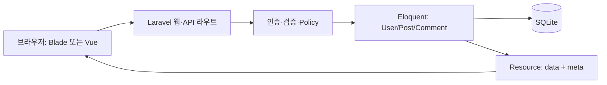

# studyMidpoint · 중간 응용 · 회원 게시판

학습 기준: [Laravel 노션](https://app.notion.com/p/3fdd7dec5e2e81299ce9e33e7ba75edf) · 단일 구성: Laravel + Vue · [전체 순서](README.md)

이 저장소는 완성된 학습 소스를 제공한다. 기초는 `demo/`, 심화는 `project/`에서 실행한다. 단계별 파일은 기존 study 문서를 덮어써 갱신했으며, 아래 소스는 현재 저장소의 실제 전문이다. 처음부터 만들 때는 해당 경로의 파일과 앞 단계의 준비를 함께 적용한다.

## ① 목표 한 줄

study0~10의 로그인·글·댓글·검색을 Laravel 안의 한 서비스로 완성한다.

## ② 📖 이론

### 기능 목록

- Blade의 가입·로그인·로그아웃과 작성자 전용 글 CRUD
- 같은 DB를 읽는 Vue 게시판, 메모리 토큰 로그인, 댓글 작성·삭제
- 제목·본문 검색, 정렬, 1부터 시작하는 페이지, JSON 태그
- 설정 파일·세션 저장, 검증 오류, Policy, XSS 이스케이프, 테스트

이 구간은 큐·AI·외부 결제·OAuth 없이 기초에서 설명한 도구만 사용한다. 목표는 기능을 많이 붙이는 것보다 입력 한 건이 검증·권한·저장·응답·화면을 통과하는 전체 흐름을 이해하는 것이다.

## ③ 🛠️ 실기 · 전체 코드와 줄별 설명

### 폴더 구조

```text
demo/
  routes/                 웹·API 주소
  app/Http/Controllers/   요청과 인증
  app/Http/Resources/     공통 JSON 모양
  app/Models/             User, Post, Comment
  app/Policies/           작성자 권한
  app/Support/            TagNames 순수 규칙
  resources/views/        Blade 화면
  resources/js/           Vue 화면과 Pinia 스토어
  database/migrations/    회원·글·댓글·토큰·태그
  tests/                  순수 함수·요청·DB 계약
```

### 단계별 구현 순서

1. study0의 환경과 .env를 준비하고 빈 DB에 migrate한다.
2. study1~4의 MVC와 URL을 확인하고 Post·Comment·User 관계를 만든다.
3. study5의 폼 검증과 오류 복원을 연결하고 Blade CRUD를 수행한다.
4. study6의 /api JSON, 태그 배열, 페이지·검색, Location·204를 맞춘다.
5. study7의 세션·Sanctum·Policy로 쓰기를 제한한다.
6. study3·5·8에서 익힌 ref·Pinia request·폼 처리로 /app을 연결한다.
7. study9 테스트와 study10 빌드·배포 점검표를 통과시킨다.

아래 파일은 조립된 기초 서비스의 전체 핵심 코드다. 나머지 모델·인증·Resource 전체 코드는 해당 study에서 이미 제공했다.

### 실행 명령

```powershell
cd demo
composer install
npm ci
php artisan migrate
php artisan db:seed
npm run build
php artisan test --compact
php artisan serve --host=127.0.0.1 --port=8000
# 브라우저: http://127.0.0.1:8000/app
```

명령은 위에서 아래로 실행한다. `cd`는 작업 폴더 이동, `php artisan`은 Laravel 작업, `composer`는 PHP 의존성, `npm`은 Vue 자산 도구, `docker compose`는 연결 서비스를 담당한다. 주석에 별도 터미널·운영 환경·선택 실습이 지정되어 있으면 그 경계를 유지한다.

### `demo/app/Http/Controllers/Api/ContractController.php` 전체 코드

[demo/app/Http/Controllers/Api/ContractController.php](demo/app/Http/Controllers/Api/ContractController.php)를 해당 경로에 둔다. 아래 블록에는 생략된 코드가 없다.

```php
<?php

namespace App\Http\Controllers\Api;

use App\Http\Controllers\Controller;
use App\Http\Resources\EntryResource;
use App\Services\LibraryStats;
use App\Support\TagNames;
use Illuminate\Http\JsonResponse;
use Illuminate\Http\Request;
use Illuminate\Support\Facades\DB;
use Illuminate\Support\Facades\Gate;
use Symfony\Component\HttpFoundation\Response;

class ContractController extends Controller
{
    public function index(Request $request): JsonResponse
    {
        $request->validate(['q' => ['nullable', 'string', 'max:200'], 'page' => ['sometimes', 'integer', 'min:1'],
            'limit' => ['sometimes', 'integer', 'min:1'], 'sort' => ['sometimes', 'in:createdAt,-createdAt,-commentCount']]);
        $query = config('study.model')::query()->with(['user'])->search($request->query('q'));
        $query->withCount('comments');
        $sort = $request->query('sort', '-createdAt');
        if ($sort === '-commentCount') {
            $query->orderByDesc('comments_count');
        } else {
            $query->orderBy('created_at', $sort === 'createdAt' ? 'asc' : 'desc');
        }
        $items = $query->orderBy('id', $sort === 'createdAt' ? 'asc' : 'desc')
            ->paginate(min($request->integer('limit', 10), 50));

        return response()->json(['data' => EntryResource::collection($items)->resolve($request), 'meta' => [
            'page' => $items->currentPage(), 'limit' => $items->perPage(), 'total' => $items->total(),
            'totalPages' => $items->lastPage(), 'q' => $request->query('q', ''),
        ]]);
    }

    public function show(int $id): EntryResource
    {
        return new EntryResource(config('study.model')::query()->with(['user'])->withCount('comments')->findOrFail($id));
    }

    public function store(Request $request): JsonResponse
    {
        $data = $this->validated($request);
        if (isset($data['tags'])) {
            $data['tags'] = TagNames::normalize($data['tags']);
        }
        $entry = DB::transaction(function () use ($request, $data) {
            $relation = config('study.relation');
            $entry = $request->user()->{$relation}()->create($data);

            return $entry;
        });
        app(LibraryStats::class)->invalidate();

        return (new EntryResource($entry->load(['user'])))->response()->setStatusCode(201)
            ->header('Location', '/api/posts/'.$entry->id);
    }

    public function update(Request $request, int $id): EntryResource
    {
        $entry = config('study.model')::query()->findOrFail($id);
        Gate::authorize('update', $entry);
        $data = $this->validated($request, true);
        if (isset($data['tags'])) {
            $data['tags'] = TagNames::normalize($data['tags']);
        }
        DB::transaction(function () use ($entry, $data): void {
            $entry->update($data);

        });

        return new EntryResource($entry->load(['user'])->loadCount('comments'));
    }

    public function destroy(int $id): Response
    {
        $entry = config('study.model')::query()->findOrFail($id);
        Gate::authorize('delete', $entry);
        $entry->delete();
        app(LibraryStats::class)->invalidate();

        return response()->noContent();
    }

    private function validated(Request $request, bool $partial = false): array
    {
        return $request->validate([
            'title' => [$partial ? 'sometimes' : 'required', 'required', 'string', 'max:200'],
            'body' => [$partial ? 'sometimes' : 'required', 'required', 'string', 'max:20000'],
            'tags' => ['sometimes', 'array', 'max:8'], 'tags.*' => ['required', 'string', 'max:30', 'distinct'],
        ]);
    }
}
```

#### 줄별 설명

| 줄 | 설명 |
|---:|---|
| 1 | PHP 코드 시작을 선언한다. |
| 2 | 가독성을 위한 빈 줄이며 실행 동작은 없다. |
| 3 | 이 클래스가 속한 이름 공간을 지정해 같은 이름의 충돌을 막는다. |
| 4 | 가독성을 위한 빈 줄이며 실행 동작은 없다. |
| 5 | 다른 클래스·트레이트·파사드를 현재 파일의 짧은 이름으로 가져온다. |
| 6 | 다른 클래스·트레이트·파사드를 현재 파일의 짧은 이름으로 가져온다. |
| 7 | 다른 클래스·트레이트·파사드를 현재 파일의 짧은 이름으로 가져온다. |
| 8 | 다른 클래스·트레이트·파사드를 현재 파일의 짧은 이름으로 가져온다. |
| 9 | 다른 클래스·트레이트·파사드를 현재 파일의 짧은 이름으로 가져온다. |
| 10 | 다른 클래스·트레이트·파사드를 현재 파일의 짧은 이름으로 가져온다. |
| 11 | 다른 클래스·트레이트·파사드를 현재 파일의 짧은 이름으로 가져온다. |
| 12 | 다른 클래스·트레이트·파사드를 현재 파일의 짧은 이름으로 가져온다. |
| 13 | 다른 클래스·트레이트·파사드를 현재 파일의 짧은 이름으로 가져온다. |
| 14 | 가독성을 위한 빈 줄이며 실행 동작은 없다. |
| 15 | 앞서 선언한 처리의 연속 구문이다. 같은 함수·설정 블록의 입력과 결과에 연결된다. |
| 16 | 현재 선언·조건·설정의 내부 블록을 연다. |
| 17 | `index` 메서드를 선언한다. 목록을 조회해 응답으로 반환하는 진입점이다. |
| 18 | 현재 선언·조건·설정의 내부 블록을 연다. |
| 19 | 서버 경계에서 입력을 검증하고 허용한 필드만 돌려받는다. |
| 20 | 배열·객체·설정의 키에 값 또는 처리 함수를 연결한다. |
| 21 | 관계를 미리 조회하거나 리다이렉트의 일회성 상태값을 전달한다. |
| 22 | 관계 행 수를 추가 쿼리 반복 없이 count 필드로 읽는다. |
| 23 | 이후 처리에 사용할 값이나 의존성을 변수·객체 속성에 저장한다. |
| 24 | 조건을 검사해 성공·실패 또는 선택 기능의 흐름을 나눈다. |
| 25 | 허용한 정렬 기준을 DB 쿼리에 적용한다. |
| 26 | 앞서 선언한 처리의 연속 구문이다. 같은 함수·설정 블록의 입력과 결과에 연결된다. |
| 27 | 허용한 정렬 기준을 DB 쿼리에 적용한다. |
| 28 | 현재 블록·배열·호출을 닫고 상위 흐름으로 돌아간다. |
| 29 | 허용한 정렬 기준을 DB 쿼리에 적용한다. |
| 30 | 전체 건수와 현재 페이지를 계산하고 페이지 크기를 제한한다. |
| 31 | 가독성을 위한 빈 줄이며 실행 동작은 없다. |
| 32 | 계약에 맞는 HTTP 응답 본문·상태·헤더를 만들어 반환한다. |
| 33 | 배열·객체·설정의 키에 값 또는 처리 함수를 연결한다. |
| 34 | 배열·객체·설정의 키에 값 또는 처리 함수를 연결한다. |
| 35 | 앞서 선언한 처리의 연속 구문이다. 같은 함수·설정 블록의 입력과 결과에 연결된다. |
| 36 | 현재 블록·배열·호출을 닫고 상위 흐름으로 돌아간다. |
| 37 | 가독성을 위한 빈 줄이며 실행 동작은 없다. |
| 38 | `show` 메서드를 선언한다. 지정한 자원 한 건을 조회하는 진입점이다. |
| 39 | 현재 선언·조건·설정의 내부 블록을 연다. |
| 40 | 관계 행 수를 추가 쿼리 반복 없이 count 필드로 읽는다. |
| 41 | 현재 블록·배열·호출을 닫고 상위 흐름으로 돌아간다. |
| 42 | 가독성을 위한 빈 줄이며 실행 동작은 없다. |
| 43 | `store` 메서드를 선언한다. 검증한 입력으로 자원을 생성하는 진입점이다. |
| 44 | 현재 선언·조건·설정의 내부 블록을 연다. |
| 45 | 이후 처리에 사용할 값이나 의존성을 변수·객체 속성에 저장한다. |
| 46 | 조건을 검사해 성공·실패 또는 선택 기능의 흐름을 나눈다. |
| 47 | 배열·객체·설정의 키에 값 또는 처리 함수를 연결한다. |
| 48 | 현재 블록·배열·호출을 닫고 상위 흐름으로 돌아간다. |
| 49 | 묶인 DB 변경이 함께 성공하거나 함께 취소되도록 트랜잭션을 연다. |
| 50 | 환경에 맞게 로드한 설정값을 읽는다. |
| 51 | 검증한 속성으로 새 행을 저장하거나 작업 객체를 생성한다. |
| 52 | 가독성을 위한 빈 줄이며 실행 동작은 없다. |
| 53 | 구성한 값·모델·응답을 현재 함수의 호출자에게 돌려준다. |
| 54 | 현재 블록·배열·호출을 닫고 상위 흐름으로 돌아간다. |
| 55 | 배열·객체·설정의 키에 값 또는 처리 함수를 연결한다. |
| 56 | 가독성을 위한 빈 줄이며 실행 동작은 없다. |
| 57 | 응답에 필요한 관계 데이터를 모델에 추가로 불러온다. |
| 58 | 앞서 선언한 처리의 연속 구문이다. 같은 함수·설정 블록의 입력과 결과에 연결된다. |
| 59 | 현재 블록·배열·호출을 닫고 상위 흐름으로 돌아간다. |
| 60 | 가독성을 위한 빈 줄이며 실행 동작은 없다. |
| 61 | `update` 메서드를 선언한다. 소유권 확인 뒤 전달된 필드만 수정하는 진입점이다. |
| 62 | 현재 선언·조건·설정의 내부 블록을 연다. |
| 63 | 모델에 대응하는 테이블 또는 컬렉션의 조회를 시작한다. |
| 64 | 현재 사용자가 지정한 모델 동작을 수행할 수 있는지 Policy에 묻는다. |
| 65 | 이후 처리에 사용할 값이나 의존성을 변수·객체 속성에 저장한다. |
| 66 | 조건을 검사해 성공·실패 또는 선택 기능의 흐름을 나눈다. |
| 67 | 배열·객체·설정의 키에 값 또는 처리 함수를 연결한다. |
| 68 | 현재 블록·배열·호출을 닫고 상위 흐름으로 돌아간다. |
| 69 | 묶인 DB 변경이 함께 성공하거나 함께 취소되도록 트랜잭션을 연다. |
| 70 | 이미 확인한 행에 전달된 변경값을 저장한다. |
| 71 | 가독성을 위한 빈 줄이며 실행 동작은 없다. |
| 72 | 현재 블록·배열·호출을 닫고 상위 흐름으로 돌아간다. |
| 73 | 가독성을 위한 빈 줄이며 실행 동작은 없다. |
| 74 | 응답에 필요한 관계 데이터를 모델에 추가로 불러온다. |
| 75 | 현재 블록·배열·호출을 닫고 상위 흐름으로 돌아간다. |
| 76 | 가독성을 위한 빈 줄이며 실행 동작은 없다. |
| 77 | `destroy` 메서드를 선언한다. 권한 확인 뒤 자원을 삭제하는 진입점이다. |
| 78 | 현재 선언·조건·설정의 내부 블록을 연다. |
| 79 | 모델에 대응하는 테이블 또는 컬렉션의 조회를 시작한다. |
| 80 | 현재 사용자가 지정한 모델 동작을 수행할 수 있는지 Policy에 묻는다. |
| 81 | 대상 행·토큰·파일을 제거한다. 앞선 소유권 검사를 함께 읽는다. |
| 82 | 배열·객체·설정의 키에 값 또는 처리 함수를 연결한다. |
| 83 | 가독성을 위한 빈 줄이며 실행 동작은 없다. |
| 84 | 계약에 맞는 HTTP 응답 본문·상태·헤더를 만들어 반환한다. |
| 85 | 현재 블록·배열·호출을 닫고 상위 흐름으로 돌아간다. |
| 86 | 가독성을 위한 빈 줄이며 실행 동작은 없다. |
| 87 | `validated` 메서드를 선언한다. 저장할 입력의 타입·길이·필수 여부를 확정한다. |
| 88 | 현재 선언·조건·설정의 내부 블록을 연다. |
| 89 | 서버 경계에서 입력을 검증하고 허용한 필드만 돌려받는다. |
| 90 | 배열·객체·설정의 키에 값 또는 처리 함수를 연결한다. |
| 91 | 배열·객체·설정의 키에 값 또는 처리 함수를 연결한다. |
| 92 | 배열·객체·설정의 키에 값 또는 처리 함수를 연결한다. |
| 93 | 현재 블록·배열·호출을 닫고 상위 흐름으로 돌아간다. |
| 94 | 현재 블록·배열·호출을 닫고 상위 흐름으로 돌아간다. |
| 95 | 현재 블록·배열·호출을 닫고 상위 흐름으로 돌아간다. |


### `demo/app/Http/Controllers/Api/CommentContractController.php` 전체 코드

[demo/app/Http/Controllers/Api/CommentContractController.php](demo/app/Http/Controllers/Api/CommentContractController.php)를 해당 경로에 둔다. 아래 블록에는 생략된 코드가 없다.

```php
<?php

namespace App\Http\Controllers\Api;

use App\Http\Controllers\Controller;
use App\Models\Comment;
use App\Models\Post;
use Illuminate\Http\JsonResponse;
use Illuminate\Http\Request;
use Illuminate\Support\Facades\Gate;
use Symfony\Component\HttpFoundation\Response;

class CommentContractController extends Controller
{
    public function index(Post $post): JsonResponse
    {
        return response()->json(['data' => $post->comments()->with('user')->oldest('id')->get()->map($this->serialize(...))]);
    }

    public function store(Request $request, Post $post): JsonResponse
    {
        $data = $request->validate(['body' => ['required', 'string', 'max:1000']]);
        $comment = $post->comments()->make($data);
        $comment->user()->associate($request->user());
        $comment->save();

        return response()->json(['data' => $this->serialize($comment->load('user'))], 201);
    }

    public function destroy(Comment $comment): Response
    {
        Gate::authorize('delete', $comment);
        $comment->delete();

        return response()->noContent();
    }

    private function serialize(Comment $comment): array
    {
        return ['id' => $comment->id, 'postId' => $comment->post_id, 'body' => $comment->body,
            'author' => $comment->user ? ['id' => $comment->user->id, 'nickname' => $comment->user->name] : null,
            'createdAt' => $comment->created_at?->utc()->toISOString()];
    }
}
```

#### 줄별 설명

| 줄 | 설명 |
|---:|---|
| 1 | PHP 코드 시작을 선언한다. |
| 2 | 가독성을 위한 빈 줄이며 실행 동작은 없다. |
| 3 | 이 클래스가 속한 이름 공간을 지정해 같은 이름의 충돌을 막는다. |
| 4 | 가독성을 위한 빈 줄이며 실행 동작은 없다. |
| 5 | 다른 클래스·트레이트·파사드를 현재 파일의 짧은 이름으로 가져온다. |
| 6 | 다른 클래스·트레이트·파사드를 현재 파일의 짧은 이름으로 가져온다. |
| 7 | 다른 클래스·트레이트·파사드를 현재 파일의 짧은 이름으로 가져온다. |
| 8 | 다른 클래스·트레이트·파사드를 현재 파일의 짧은 이름으로 가져온다. |
| 9 | 다른 클래스·트레이트·파사드를 현재 파일의 짧은 이름으로 가져온다. |
| 10 | 다른 클래스·트레이트·파사드를 현재 파일의 짧은 이름으로 가져온다. |
| 11 | 다른 클래스·트레이트·파사드를 현재 파일의 짧은 이름으로 가져온다. |
| 12 | 가독성을 위한 빈 줄이며 실행 동작은 없다. |
| 13 | 앞서 선언한 처리의 연속 구문이다. 같은 함수·설정 블록의 입력과 결과에 연결된다. |
| 14 | 현재 선언·조건·설정의 내부 블록을 연다. |
| 15 | `index` 메서드를 선언한다. 목록을 조회해 응답으로 반환하는 진입점이다. |
| 16 | 현재 선언·조건·설정의 내부 블록을 연다. |
| 17 | 관계를 미리 조회하거나 리다이렉트의 일회성 상태값을 전달한다. |
| 18 | 현재 블록·배열·호출을 닫고 상위 흐름으로 돌아간다. |
| 19 | 가독성을 위한 빈 줄이며 실행 동작은 없다. |
| 20 | `store` 메서드를 선언한다. 검증한 입력으로 자원을 생성하는 진입점이다. |
| 21 | 현재 선언·조건·설정의 내부 블록을 연다. |
| 22 | 서버 경계에서 입력을 검증하고 허용한 필드만 돌려받는다. |
| 23 | 이후 처리에 사용할 값이나 의존성을 변수·객체 속성에 저장한다. |
| 24 | 앞서 선언한 처리의 연속 구문이다. 같은 함수·설정 블록의 입력과 결과에 연결된다. |
| 25 | 앞서 선언한 처리의 연속 구문이다. 같은 함수·설정 블록의 입력과 결과에 연결된다. |
| 26 | 가독성을 위한 빈 줄이며 실행 동작은 없다. |
| 27 | 응답에 필요한 관계 데이터를 모델에 추가로 불러온다. |
| 28 | 현재 블록·배열·호출을 닫고 상위 흐름으로 돌아간다. |
| 29 | 가독성을 위한 빈 줄이며 실행 동작은 없다. |
| 30 | `destroy` 메서드를 선언한다. 권한 확인 뒤 자원을 삭제하는 진입점이다. |
| 31 | 현재 선언·조건·설정의 내부 블록을 연다. |
| 32 | 현재 사용자가 지정한 모델 동작을 수행할 수 있는지 Policy에 묻는다. |
| 33 | 대상 행·토큰·파일을 제거한다. 앞선 소유권 검사를 함께 읽는다. |
| 34 | 가독성을 위한 빈 줄이며 실행 동작은 없다. |
| 35 | 계약에 맞는 HTTP 응답 본문·상태·헤더를 만들어 반환한다. |
| 36 | 현재 블록·배열·호출을 닫고 상위 흐름으로 돌아간다. |
| 37 | 가독성을 위한 빈 줄이며 실행 동작은 없다. |
| 38 | `serialize` 메서드를 선언한다. 호출자에게 제공할 입력·출력 경계를 정한다. |
| 39 | 현재 선언·조건·설정의 내부 블록을 연다. |
| 40 | 구성한 값·모델·응답을 현재 함수의 호출자에게 돌려준다. |
| 41 | 배열·객체·설정의 키에 값 또는 처리 함수를 연결한다. |
| 42 | 배열·객체·설정의 키에 값 또는 처리 함수를 연결한다. |
| 43 | 현재 블록·배열·호출을 닫고 상위 흐름으로 돌아간다. |
| 44 | 현재 블록·배열·호출을 닫고 상위 흐름으로 돌아간다. |


### `demo/resources/js/App.vue` 전체 코드

[demo/resources/js/App.vue](demo/resources/js/App.vue)를 해당 경로에 둔다. 아래 블록에는 생략된 코드가 없다.

```vue
<script setup>
import { onMounted, ref } from 'vue';
import { useForm } from 'vee-validate';
import { useAuth } from './stores/auth';
const props = defineProps({ advanced: Boolean });
const auth = useAuth();
const entries = ref([]), meta = ref({ page: 1, totalPages: 1 }), query = ref('');
const message = ref(''), busy = ref(false), signup = ref(false), editing = ref(null);
const title = ref(''), body = ref(''), tags = ref('');
const documents = ref([]), file = ref(null), selectedDocument = ref(null), question = ref(''), answer = ref('');
const notifications = ref([]), comments = ref({}), replies = ref({});
async function showComments(id) { comments.value[id] = (await auth.request(`/api/posts/${id}/comments`)).data; }
async function reply(id) { await run(async () => { await auth.request(`/api/posts/${id}/comments`, { method: 'POST', body: JSON.stringify({ body: replies.value[id] }) }); replies.value[id] = ''; await showComments(id); }); }
async function removeComment(id, postId) { await run(async () => { await auth.request(`/api/comments/${id}`, { method: 'DELETE' }); await showComments(postId); }); }
const { defineField, handleSubmit, errors, setErrors } = useForm({
    initialValues: { email: '', password: '', nickname: '' },
    validationSchema: {
        email: value => /^[^\s@]+@[^\s@]+\.[^\s@]+$/.test(value || '') || '이메일을 입력하세요.',
        password: value => (value?.length >= 8) || '비밀번호는 8자 이상입니다.',
    },
});
const [email, emailAttrs] = defineField('email');
const [password, passwordAttrs] = defineField('password');
const [nickname, nicknameAttrs] = defineField('nickname');
async function run(action) {
    if (busy.value) return;
    busy.value = true; message.value = '';
    try { await action(); }
    catch (error) { message.value = `${error.status || ''} ${error.message}`; setErrors(error.fields || {}); }
    finally { busy.value = false; }
}
async function load(page = 1) {
    const result = await auth.request(`/api/posts?${new URLSearchParams({ q: query.value, page, limit: 5 })}`);
    entries.value = result.data; meta.value = result.meta;
}
async function loadDocuments() {
    if (!props.advanced || !auth.user) return;
    documents.value = (await auth.request('/api/documents')).data;
    notifications.value = (await auth.request('/api/notifications')).data;
}
const submitLogin = handleSubmit(values => run(async () => {
    await auth.login(values, signup.value);
    await load(); await loadDocuments();
}));
function edit(entry) { editing.value = entry.id; title.value = entry.title; body.value = entry.body; tags.value = entry.tags.join(', '); }
function reset() { editing.value = null; title.value = ''; body.value = ''; tags.value = ''; }
async function save() {
    await run(async () => {
        await auth.request(`/api/posts${editing.value ? `/${editing.value}` : ''}`, {
            method: editing.value ? 'PATCH' : 'POST',
            body: JSON.stringify({ title: title.value, body: body.value, tags: tags.value.split(',').map(x => x.trim()).filter(Boolean) }),
        });
        reset(); await load(); message.value = '저장했습니다.';
    });
}
async function remove(entry) {
    if (!window.confirm(`“${entry.title}”을 삭제할까요?`)) return;
    await run(async () => { await auth.request(`/api/posts/${entry.id}`, { method: 'DELETE' }); await load(); });
}
async function logout() { await run(async () => { await auth.logout(); documents.value = []; notifications.value = []; reset(); }); }
async function upload() {
    await run(async () => {
        const form = new FormData(); form.append('file', file.value);
        await auth.request('/api/documents', { method: 'POST', body: form });
        await loadDocuments(); message.value = '업로드했습니다. 큐 워커 처리 후 새로고침하세요.';
    });
}
async function ask() {
    await run(async () => {
        answer.value = '';
        const response = await fetch(`/api/documents/${selectedDocument.value}/ask`, {
            method: 'POST', headers: { 'Content-Type': 'application/json', Accept: 'text/event-stream', Authorization: `Bearer ${auth.token}` },
            body: JSON.stringify({ question: question.value }),
        });
        if (!response.ok) throw new Error((await response.json()).error?.message || 'AI 요청 실패');
        const reader = response.body.getReader(), decoder = new TextDecoder(); let buffer = '';
        while (true) {
            const { done, value } = await reader.read();
            buffer += decoder.decode(value, { stream: !done });
            let end;
            while ((end = buffer.indexOf('\n\n')) >= 0) {
                const event = buffer.slice(0, end); buffer = buffer.slice(end + 2);
                const data = event.split('\n').find(line => line.startsWith('data: '));
                if (!data) continue;
                const payload = JSON.parse(data.slice(6));
                if (payload.error) throw new Error(payload.error);
                answer.value += payload.delta || '';
            }
            if (done) break;
        }
    });
}
onMounted(() => run(() => load()));
</script>

<template>
    <main class="container py-4" style="max-width: 960px">
        <header class="d-flex justify-content-between align-items-center mb-4">
            <h1 class="h3">{{ advanced ? '학습 서재 · 문서 도우미' : 'Laravel 게시판' }}</h1>
            <a href="/">Blade 홈</a>
        </header>
        <p v-if="message" role="status" class="alert alert-info">{{ message }}</p>
        <section v-if="!auth.user" class="card card-body mb-4">
            <h2 class="h5">{{ signup ? '회원가입' : '로그인' }}</h2>
            <form @submit.prevent="submitLogin" class="d-grid gap-2">
                <label v-if="signup">닉네임 <input v-model="nickname" v-bind="nicknameAttrs" class="form-control" required maxlength="80"></label>
                <label>이메일 <input v-model="email" v-bind="emailAttrs" type="email" class="form-control" autocomplete="username"></label>
                <p v-if="errors.email" class="text-danger">{{ errors.email }}</p>
                <label>비밀번호 <input v-model="password" v-bind="passwordAttrs" type="password" :autocomplete="signup ? 'new-password' : 'current-password'" class="form-control"></label>
                <p v-if="errors.password" class="text-danger">{{ errors.password }}</p>
                <small v-if="signup">회원가입 비밀번호는 서버에서 12자 이상을 검사합니다.</small>
                <button :disabled="busy" class="btn btn-primary">{{ signup ? '가입' : '로그인' }}</button>
            </form>
            <button @click="signup = !signup" class="btn btn-link">{{ signup ? '로그인으로' : '회원가입으로' }}</button>
            <a v-if="advanced" href="/auth/github">GitHub 로그인 (Blade 세션)</a>
        </section>
        <div v-else class="d-flex gap-3 mb-3"><span>{{ auth.user.nickname }}</span><button @click="logout" :disabled="busy" class="btn btn-outline-secondary btn-sm">로그아웃</button></div>
        <form class="d-flex gap-2 mb-3" @submit.prevent="run(() => load())">
            <label class="visually-hidden" for="search">제목·본문 검색</label>
            <input id="search" v-model="query" class="form-control" placeholder="제목·본문 검색">
            <button :disabled="busy" class="btn btn-secondary">검색</button>
        </form>
        <article v-for="entry in entries" :key="entry.id" class="card card-body mb-2">
            <h2 class="h5">{{ entry.title }}</h2><p style="white-space: pre-wrap">{{ entry.body }}</p>
            <small>{{ entry.author?.nickname || '탈퇴 회원' }} · {{ entry.tags.join(', ') }} · {{ new Date(entry.createdAt).toLocaleString() }}</small>
            <div v-if="auth.user?.id === entry.author?.id" class="mt-2 d-flex gap-2">
                <button @click="edit(entry)" class="btn btn-sm btn-outline-primary">수정</button>
                <button @click="remove(entry)" :disabled="busy" class="btn btn-sm btn-outline-danger">삭제</button>
            </div>
            <button @click="run(() => showComments(entry.id))" :disabled="busy" class="btn btn-link text-start">댓글 보기</button>
            <ul v-if="comments[entry.id]"><li v-for="comment in comments[entry.id]" :key="comment.id">{{ comment.body }} · {{ comment.author?.nickname }} <button v-if="auth.user?.id === comment.author?.id" @click="removeComment(comment.id, entry.id)" :disabled="busy" class="btn btn-link btn-sm">댓글 삭제</button></li></ul>
            <form v-if="auth.user" @submit.prevent="reply(entry.id)" class="d-flex gap-2"><label class="flex-grow-1">댓글 <input v-model="replies[entry.id]" required maxlength="1000" class="form-control"></label><button :disabled="busy" class="btn btn-outline-primary">등록</button></form>
        </article>
        <nav class="d-flex gap-3 my-3" aria-label="목록 페이지">
            <button @click="run(() => load(meta.page - 1))" :disabled="busy || meta.page <= 1" class="btn btn-outline-secondary">이전</button>
            <span>{{ meta.page }} / {{ meta.totalPages }}</span>
            <button @click="run(() => load(meta.page + 1))" :disabled="busy || meta.page >= meta.totalPages" class="btn btn-outline-secondary">다음</button>
        </nav>
        <form v-if="auth.user" @submit.prevent="save" class="card card-body d-grid gap-2">
            <h2 class="h5">{{ editing ? '수정' : '새 글' }}</h2>
            <label>제목 <input v-model="title" required maxlength="200" class="form-control"></label>
            <p v-if="errors.title" class="text-danger">{{ errors.title }}</p>
            <label>본문 <textarea v-model="body" required maxlength="20000" class="form-control" rows="4"></textarea></label>
            <p v-if="errors.body" class="text-danger">{{ errors.body }}</p>
            <label>태그 (쉼표로 구분) <input v-model="tags" class="form-control"></label>
            <button :disabled="busy" class="btn btn-primary">저장</button>
            <button v-if="editing" type="button" @click="reset" class="btn btn-light">수정 취소</button>
        </form>
        <section v-if="advanced && auth.user" class="card card-body mt-4 d-grid gap-3">
            <h2 class="h5">DocuForge 학습 기능: 텍스트 문서 요약·근거 질문</h2>
            <p>기본 설정은 mock입니다. 실제 AI는 AI_DRIVER=ollama로 전환합니다. TXT/MD, UTF-8, 최대 100KB.</p>
            <form @submit.prevent="upload" class="d-grid gap-2">
                <label>문서 파일 <input type="file" accept=".txt,.md" required @change="file = $event.target.files[0]" class="form-control"></label>
                <button :disabled="busy" class="btn btn-primary">업로드·요약 예약</button>
            </form>
            <button @click="run(loadDocuments)" :disabled="busy" class="btn btn-outline-secondary">문서·알림 새로고침</button>
            <ul><li v-for="document in documents" :key="document.id">{{ document.filename }} · {{ document.status }}<p>{{ document.summary }}</p></li></ul>
            <form @submit.prevent="ask" class="d-grid gap-2">
                <label>문서 선택 <select v-model="selectedDocument" required class="form-select"><option v-for="document in documents" :key="document.id" :value="document.id">{{ document.filename }}</option></select></label>
                <label>질문 <input v-model="question" required maxlength="1000" class="form-control"></label>
                <button :disabled="busy" class="btn btn-primary">스트리밍 질문</button>
            </form>
            <pre aria-live="polite" style="white-space: pre-wrap">{{ answer }}</pre>
            <h3 class="h6">알림</h3><ul><li v-for="notification in notifications" :key="notification.id">{{ notification.data.message }}</li></ul>
        </section>
    </main>
</template>
```

#### 줄별 설명

| 줄 | 설명 |
|---:|---|
| 1 | 화면 요소·접근성 속성·텍스트 영역을 선언한다. 중괄호 출력은 기본 이스케이프한다. |
| 2 | 번들러가 Vue·라이브러리·공통 모듈 또는 CSS 의존성을 가져온다. |
| 3 | 번들러가 Vue·라이브러리·공통 모듈 또는 CSS 의존성을 가져온다. |
| 4 | 번들러가 Vue·라이브러리·공통 모듈 또는 CSS 의존성을 가져온다. |
| 5 | 부모 또는 마운트 진입점에서 전달받는 읽기 전용 입력을 선언한다. |
| 6 | 이후 처리에 사용할 값이나 의존성을 변수·객체 속성에 저장한다. |
| 7 | 화면이 변경을 관찰할 반응형 상태를 초기화한다. |
| 8 | 화면이 변경을 관찰할 반응형 상태를 초기화한다. |
| 9 | 화면이 변경을 관찰할 반응형 상태를 초기화한다. |
| 10 | 화면이 변경을 관찰할 반응형 상태를 초기화한다. |
| 11 | 화면이 변경을 관찰할 반응형 상태를 초기화한다. |
| 12 | 같은 Laravel 서버에 비동기 HTTP 요청을 보낸다. |
| 13 | 같은 Laravel 서버에 비동기 HTTP 요청을 보낸다. |
| 14 | 같은 Laravel 서버에 비동기 HTTP 요청을 보낸다. |
| 15 | 폼 입력·오류 상태를 필드와 연결한다. |
| 16 | 민감한 인증 설정의 참조 또는 예시 자리다. 실제 값은 환경·비밀 저장소에만 둔다. |
| 17 | 배열·객체·설정의 키에 값 또는 처리 함수를 연결한다. |
| 18 | 배열·객체·설정의 키에 값 또는 처리 함수를 연결한다. |
| 19 | 민감한 인증 설정의 참조 또는 예시 자리다. 실제 값은 환경·비밀 저장소에만 둔다. |
| 20 | 현재 블록·배열·호출을 닫고 상위 흐름으로 돌아간다. |
| 21 | 현재 블록·배열·호출을 닫고 상위 흐름으로 돌아간다. |
| 22 | 폼 입력·오류 상태를 필드와 연결한다. |
| 23 | 폼 입력·오류 상태를 필드와 연결한다. |
| 24 | 폼 입력·오류 상태를 필드와 연결한다. |
| 25 | 재사용할 화면 동작을 함수로 선언한다. async 함수는 HTTP 완료를 기다릴 수 있다. |
| 26 | 조건을 검사해 성공·실패 또는 선택 기능의 흐름을 나눈다. |
| 27 | 이후 처리에 사용할 값이나 의존성을 변수·객체 속성에 저장한다. |
| 28 | 실패 처리와 정리 동작을 분리해 부분 결과를 성공으로 취급하지 않는다. |
| 29 | 실패 처리와 정리 동작을 분리해 부분 결과를 성공으로 취급하지 않는다. |
| 30 | 실패 처리와 정리 동작을 분리해 부분 결과를 성공으로 취급하지 않는다. |
| 31 | 현재 블록·배열·호출을 닫고 상위 흐름으로 돌아간다. |
| 32 | 재사용할 화면 동작을 함수로 선언한다. async 함수는 HTTP 완료를 기다릴 수 있다. |
| 33 | 같은 Laravel 서버에 비동기 HTTP 요청을 보낸다. |
| 34 | 이후 처리에 사용할 값이나 의존성을 변수·객체 속성에 저장한다. |
| 35 | 현재 블록·배열·호출을 닫고 상위 흐름으로 돌아간다. |
| 36 | 재사용할 화면 동작을 함수로 선언한다. async 함수는 HTTP 완료를 기다릴 수 있다. |
| 37 | 조건을 검사해 성공·실패 또는 선택 기능의 흐름을 나눈다. |
| 38 | 같은 Laravel 서버에 비동기 HTTP 요청을 보낸다. |
| 39 | 같은 Laravel 서버에 비동기 HTTP 요청을 보낸다. |
| 40 | 현재 블록·배열·호출을 닫고 상위 흐름으로 돌아간다. |
| 41 | 배열·객체·설정의 키에 값 또는 처리 함수를 연결한다. |
| 42 | 앞서 선언한 처리의 연속 구문이다. 같은 함수·설정 블록의 입력과 결과에 연결된다. |
| 43 | 앞서 선언한 처리의 연속 구문이다. 같은 함수·설정 블록의 입력과 결과에 연결된다. |
| 44 | 앞서 선언한 처리의 연속 구문이다. 같은 함수·설정 블록의 입력과 결과에 연결된다. |
| 45 | 재사용할 화면 동작을 함수로 선언한다. async 함수는 HTTP 완료를 기다릴 수 있다. |
| 46 | 재사용할 화면 동작을 함수로 선언한다. async 함수는 HTTP 완료를 기다릴 수 있다. |
| 47 | 재사용할 화면 동작을 함수로 선언한다. async 함수는 HTTP 완료를 기다릴 수 있다. |
| 48 | 배열·객체·설정의 키에 값 또는 처리 함수를 연결한다. |
| 49 | 같은 Laravel 서버에 비동기 HTTP 요청을 보낸다. |
| 50 | 배열·객체·설정의 키에 값 또는 처리 함수를 연결한다. |
| 51 | 브라우저 상태를 API 요청 JSON 본문으로 변환한다. |
| 52 | 현재 블록·배열·호출을 닫고 상위 흐름으로 돌아간다. |
| 53 | 이후 처리에 사용할 값이나 의존성을 변수·객체 속성에 저장한다. |
| 54 | 현재 블록·배열·호출을 닫고 상위 흐름으로 돌아간다. |
| 55 | 현재 블록·배열·호출을 닫고 상위 흐름으로 돌아간다. |
| 56 | 재사용할 화면 동작을 함수로 선언한다. async 함수는 HTTP 완료를 기다릴 수 있다. |
| 57 | 조건을 검사해 성공·실패 또는 선택 기능의 흐름을 나눈다. |
| 58 | 같은 Laravel 서버에 비동기 HTTP 요청을 보낸다. |
| 59 | 현재 블록·배열·호출을 닫고 상위 흐름으로 돌아간다. |
| 60 | 재사용할 화면 동작을 함수로 선언한다. async 함수는 HTTP 완료를 기다릴 수 있다. |
| 61 | 재사용할 화면 동작을 함수로 선언한다. async 함수는 HTTP 완료를 기다릴 수 있다. |
| 62 | 배열·객체·설정의 키에 값 또는 처리 함수를 연결한다. |
| 63 | 이후 처리에 사용할 값이나 의존성을 변수·객체 속성에 저장한다. |
| 64 | 같은 Laravel 서버에 비동기 HTTP 요청을 보낸다. |
| 65 | 이후 처리에 사용할 값이나 의존성을 변수·객체 속성에 저장한다. |
| 66 | 현재 블록·배열·호출을 닫고 상위 흐름으로 돌아간다. |
| 67 | 현재 블록·배열·호출을 닫고 상위 흐름으로 돌아간다. |
| 68 | 재사용할 화면 동작을 함수로 선언한다. async 함수는 HTTP 완료를 기다릴 수 있다. |
| 69 | 배열·객체·설정의 키에 값 또는 처리 함수를 연결한다. |
| 70 | 이후 처리에 사용할 값이나 의존성을 변수·객체 속성에 저장한다. |
| 71 | 같은 Laravel 서버에 비동기 HTTP 요청을 보낸다. |
| 72 | 현재 메모리 토큰을 Bearer 인증 헤더에 연결한다. |
| 73 | 브라우저 상태를 API 요청 JSON 본문으로 변환한다. |
| 74 | 현재 블록·배열·호출을 닫고 상위 흐름으로 돌아간다. |
| 75 | 응답 JSON을 화면에서 다룰 객체로 변환한다. |
| 76 | 스트림 조각 사이에 걸친 한글 UTF-8 바이트를 보존하며 디코딩한다. |
| 77 | 목록·청크·응답 스트림의 각 항목을 순서대로 처리한다. |
| 78 | 서버 스트림의 다음 데이터 조각이 도착할 때까지 읽는다. |
| 79 | 스트림 조각 사이에 걸친 한글 UTF-8 바이트를 보존하며 디코딩한다. |
| 80 | 현재 모듈이 사용할 값 또는 외부에 제공할 인터페이스를 선언한다. |
| 81 | 목록·청크·응답 스트림의 각 항목을 순서대로 처리한다. |
| 82 | 이후 처리에 사용할 값이나 의존성을 변수·객체 속성에 저장한다. |
| 83 | 배열·객체·설정의 키에 값 또는 처리 함수를 연결한다. |
| 84 | 조건을 검사해 성공·실패 또는 선택 기능의 흐름을 나눈다. |
| 85 | 응답 JSON을 화면에서 다룰 객체로 변환한다. |
| 86 | 조건을 검사해 성공·실패 또는 선택 기능의 흐름을 나눈다. |
| 87 | 이후 처리에 사용할 값이나 의존성을 변수·객체 속성에 저장한다. |
| 88 | 현재 블록·배열·호출을 닫고 상위 흐름으로 돌아간다. |
| 89 | 조건을 검사해 성공·실패 또는 선택 기능의 흐름을 나눈다. |
| 90 | 현재 블록·배열·호출을 닫고 상위 흐름으로 돌아간다. |
| 91 | 현재 블록·배열·호출을 닫고 상위 흐름으로 돌아간다. |
| 92 | 현재 블록·배열·호출을 닫고 상위 흐름으로 돌아간다. |
| 93 | 배열·객체·설정의 키에 값 또는 처리 함수를 연결한다. |
| 94 | 화면 요소·접근성 속성·텍스트 영역을 선언한다. 중괄호 출력은 기본 이스케이프한다. |
| 95 | 가독성을 위한 빈 줄이며 실행 동작은 없다. |
| 96 | 화면 요소·접근성 속성·텍스트 영역을 선언한다. 중괄호 출력은 기본 이스케이프한다. |
| 97 | 화면 요소·접근성 속성·텍스트 영역을 선언한다. 중괄호 출력은 기본 이스케이프한다. |
| 98 | 화면 요소·접근성 속성·텍스트 영역을 선언한다. 중괄호 출력은 기본 이스케이프한다. |
| 99 | 화면 요소·접근성 속성·텍스트 영역을 선언한다. 중괄호 출력은 기본 이스케이프한다. |
| 100 | 화면 요소·접근성 속성·텍스트 영역을 선언한다. 중괄호 출력은 기본 이스케이프한다. |
| 101 | 화면 요소·접근성 속성·텍스트 영역을 선언한다. 중괄호 출력은 기본 이스케이프한다. |
| 102 | 인증·상태·오류 조건에 맞는 UI만 렌더링한다. |
| 103 | 인증·상태·오류 조건에 맞는 UI만 렌더링한다. |
| 104 | 화면 요소·접근성 속성·텍스트 영역을 선언한다. 중괄호 출력은 기본 이스케이프한다. |
| 105 | 폼의 기본 페이지 이동을 막고 정의한 제출 동작을 실행한다. |
| 106 | 입력 요소와 Vue 상태를 양방향으로 묶는다. DB 저장은 별도 요청이다. |
| 107 | 입력 요소와 Vue 상태를 양방향으로 묶는다. DB 저장은 별도 요청이다. |
| 108 | 인증·상태·오류 조건에 맞는 UI만 렌더링한다. |
| 109 | 입력 요소와 Vue 상태를 양방향으로 묶는다. DB 저장은 별도 요청이다. |
| 110 | 인증·상태·오류 조건에 맞는 UI만 렌더링한다. |
| 111 | 인증·상태·오류 조건에 맞는 UI만 렌더링한다. |
| 112 | 화면 요소·접근성 속성·텍스트 영역을 선언한다. 중괄호 출력은 기본 이스케이프한다. |
| 113 | 화면 요소·접근성 속성·텍스트 영역을 선언한다. 중괄호 출력은 기본 이스케이프한다. |
| 114 | 클릭 이벤트를 화면 동작에 연결한다. |
| 115 | 인증·상태·오류 조건에 맞는 UI만 렌더링한다. |
| 116 | 화면 요소·접근성 속성·텍스트 영역을 선언한다. 중괄호 출력은 기본 이스케이프한다. |
| 117 | 클릭 이벤트를 화면 동작에 연결한다. |
| 118 | 폼의 기본 페이지 이동을 막고 정의한 제출 동작을 실행한다. |
| 119 | 화면 요소·접근성 속성·텍스트 영역을 선언한다. 중괄호 출력은 기본 이스케이프한다. |
| 120 | 입력 요소와 Vue 상태를 양방향으로 묶는다. DB 저장은 별도 요청이다. |
| 121 | 화면 요소·접근성 속성·텍스트 영역을 선언한다. 중괄호 출력은 기본 이스케이프한다. |
| 122 | 화면 요소·접근성 속성·텍스트 영역을 선언한다. 중괄호 출력은 기본 이스케이프한다. |
| 123 | 목록 상태를 key로 구분해 반복 렌더링한다. |
| 124 | 화면 요소·접근성 속성·텍스트 영역을 선언한다. 중괄호 출력은 기본 이스케이프한다. |
| 125 | 화면 요소·접근성 속성·텍스트 영역을 선언한다. 중괄호 출력은 기본 이스케이프한다. |
| 126 | 인증·상태·오류 조건에 맞는 UI만 렌더링한다. |
| 127 | 클릭 이벤트를 화면 동작에 연결한다. |
| 128 | 클릭 이벤트를 화면 동작에 연결한다. |
| 129 | 화면 요소·접근성 속성·텍스트 영역을 선언한다. 중괄호 출력은 기본 이스케이프한다. |
| 130 | 클릭 이벤트를 화면 동작에 연결한다. |
| 131 | 목록 상태를 key로 구분해 반복 렌더링한다. |
| 132 | 입력 요소와 Vue 상태를 양방향으로 묶는다. DB 저장은 별도 요청이다. |
| 133 | 화면 요소·접근성 속성·텍스트 영역을 선언한다. 중괄호 출력은 기본 이스케이프한다. |
| 134 | 화면 요소·접근성 속성·텍스트 영역을 선언한다. 중괄호 출력은 기본 이스케이프한다. |
| 135 | 클릭 이벤트를 화면 동작에 연결한다. |
| 136 | 화면 요소·접근성 속성·텍스트 영역을 선언한다. 중괄호 출력은 기본 이스케이프한다. |
| 137 | 클릭 이벤트를 화면 동작에 연결한다. |
| 138 | 화면 요소·접근성 속성·텍스트 영역을 선언한다. 중괄호 출력은 기본 이스케이프한다. |
| 139 | 인증·상태·오류 조건에 맞는 UI만 렌더링한다. |
| 140 | 화면 요소·접근성 속성·텍스트 영역을 선언한다. 중괄호 출력은 기본 이스케이프한다. |
| 141 | 입력 요소와 Vue 상태를 양방향으로 묶는다. DB 저장은 별도 요청이다. |
| 142 | 인증·상태·오류 조건에 맞는 UI만 렌더링한다. |
| 143 | 입력 요소와 Vue 상태를 양방향으로 묶는다. DB 저장은 별도 요청이다. |
| 144 | 인증·상태·오류 조건에 맞는 UI만 렌더링한다. |
| 145 | 입력 요소와 Vue 상태를 양방향으로 묶는다. DB 저장은 별도 요청이다. |
| 146 | 화면 요소·접근성 속성·텍스트 영역을 선언한다. 중괄호 출력은 기본 이스케이프한다. |
| 147 | 인증·상태·오류 조건에 맞는 UI만 렌더링한다. |
| 148 | 화면 요소·접근성 속성·텍스트 영역을 선언한다. 중괄호 출력은 기본 이스케이프한다. |
| 149 | 인증·상태·오류 조건에 맞는 UI만 렌더링한다. |
| 150 | 화면 요소·접근성 속성·텍스트 영역을 선언한다. 중괄호 출력은 기본 이스케이프한다. |
| 151 | 화면 요소·접근성 속성·텍스트 영역을 선언한다. 중괄호 출력은 기본 이스케이프한다. |
| 152 | 폼의 기본 페이지 이동을 막고 정의한 제출 동작을 실행한다. |
| 153 | 화면 요소·접근성 속성·텍스트 영역을 선언한다. 중괄호 출력은 기본 이스케이프한다. |
| 154 | 화면 요소·접근성 속성·텍스트 영역을 선언한다. 중괄호 출력은 기본 이스케이프한다. |
| 155 | 화면 요소·접근성 속성·텍스트 영역을 선언한다. 중괄호 출력은 기본 이스케이프한다. |
| 156 | 클릭 이벤트를 화면 동작에 연결한다. |
| 157 | 목록 상태를 key로 구분해 반복 렌더링한다. |
| 158 | 폼의 기본 페이지 이동을 막고 정의한 제출 동작을 실행한다. |
| 159 | 입력 요소와 Vue 상태를 양방향으로 묶는다. DB 저장은 별도 요청이다. |
| 160 | 입력 요소와 Vue 상태를 양방향으로 묶는다. DB 저장은 별도 요청이다. |
| 161 | 화면 요소·접근성 속성·텍스트 영역을 선언한다. 중괄호 출력은 기본 이스케이프한다. |
| 162 | 화면 요소·접근성 속성·텍스트 영역을 선언한다. 중괄호 출력은 기본 이스케이프한다. |
| 163 | 화면 요소·접근성 속성·텍스트 영역을 선언한다. 중괄호 출력은 기본 이스케이프한다. |
| 164 | 목록 상태를 key로 구분해 반복 렌더링한다. |
| 165 | 화면 요소·접근성 속성·텍스트 영역을 선언한다. 중괄호 출력은 기본 이스케이프한다. |
| 166 | 화면 요소·접근성 속성·텍스트 영역을 선언한다. 중괄호 출력은 기본 이스케이프한다. |
| 167 | 화면 요소·접근성 속성·텍스트 영역을 선언한다. 중괄호 출력은 기본 이스케이프한다. |


## ④ 🔗 연동 포인트

### DB·API 연동 구성도



한 서비스 안의 두 표현 방식이며 별도 프론트 배포가 필요 없다. 다음 심화 서재는 같은 인증·API 계약을 유지하면서 Note·Tag와 문서 기능을 추가한다.

## ⑤ 오류 노트

| 증상 | 원인 | 해결 |
|---|---|---|
| Blade는 로그인인데 Vue는 손님 | 세션과 Bearer 토큰이 서로 다른 인증 수단 | Vue에서 별도로 로그인하거나 Blade 화면을 사용 |
| 댓글 개수가 안 변함 | 이전 목록 상태를 유지함 | 상세 재조회로 commentCount 확인, 댓글 목록 갱신 |
| 새 DB에서 샘플 계정 없음 | migrate와 seed는 다른 작업 | 로컬에서만 db:seed 또는 직접 가입 |

## ⑥ 직접 해보기

1. 두 계정으로 글과 댓글을 만들고 서로 삭제가 거부되는지 확인한다.
2. 검색 결과 6개를 만들어 limit=5의 두 번째 페이지를 연다.
3. 로그아웃 후 쓰기 요청이 차단되는지 확인한다.

## ⑦ ☐ 체크리스트

학습자가 직접 실행·설명한 뒤 체크한다. 코드 준비 완료와 외부 서비스 실행 검증은 다르다.

- [ ] 1차 배포: npm build·전체 테스트가 통과한다.
- [ ] 1차 배포: public만 공개하고 HTTPS·환경변수·DB 권한을 점검한다.
- [ ] 1차 배포: 운영에서 학습 시드를 실행하지 않는다.
- [ ] 1차 배포: /health·/api/posts·로그인·CRUD·권한 거부를 점검한다.

### 회고

입력 검증을 프론트에만 둘 수 없는 이유, 세션과 토큰이 공유하는 것과 따로 유지하는 것, DB 관계로 소유자를 결정하는 이유를 각각 본인 말로 적는다. 실패 요청 하나의 requestId와 해결 과정을 남긴다. 기초에서 가장 수정하기 어려웠던 중복은 심화의 서비스·Resource 분리 기준으로 사용한다.

## ⑧ 다음 단계 연결

study0~10의 로그인·글·댓글·검색을 Laravel 안의 한 서비스로 완성한다. 이 결과를 [study11.md](study11.md)에서 다음 실습과 연결한다.

### 근거·참고

[공통 API 스펙 v1](https://app.notion.com/p/3d6d7dec5e2e8139adbfd36dd506c65e) · [요구사항 매핑](docs/notion-coverage.md) · [검증 기록](docs/verification.md)

- [공식 문서 1](https://laravel.com/docs/13.x/eloquent-relationships)
